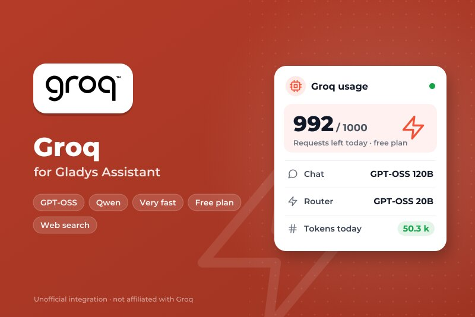
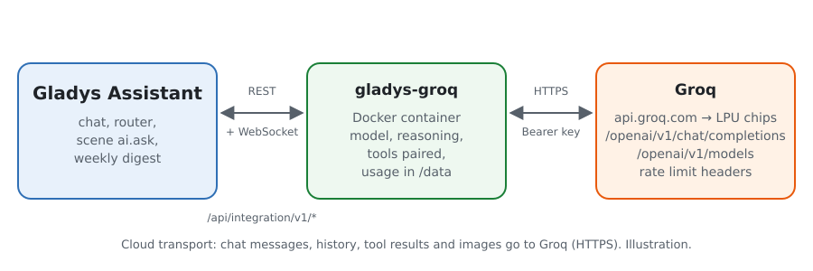
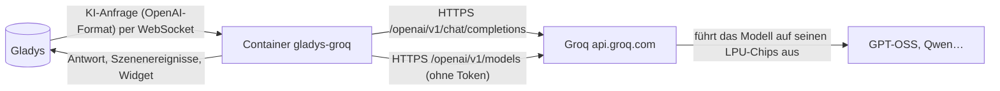
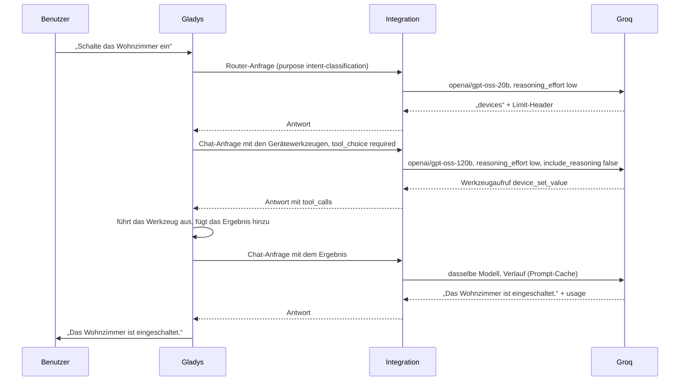
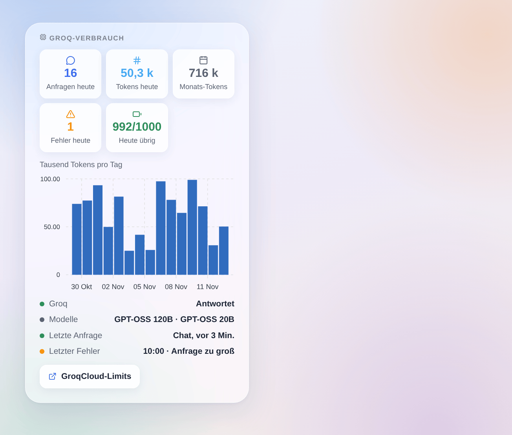

# Gladys Groq

[English](README.md) · [Français](README.fr.md) · **Deutsch** · [Español](README.es.md)

[](LICENSE)
[](https://github.com/William-De71/gladys-groq/releases)
[](https://github.com/William-De71/gladys-groq/actions/workflows/release.yml)
[](https://gladysassistant.com)



Externe Integration für [Gladys Assistant](https://gladysassistant.com), die den Assistenten von Gladys auf **Groq** laufen lässt: offene Modelle (OpenAI GPT-OSS, Qwen) auf den eigenen LPU-Chips von Groq, um ein Vielfaches schneller als üblich, sodass der Assistent fast sofort antwortet. Sobald sie unter Einstellungen → Künstliche Intelligenz gewählt ist, beantwortet das Modell deiner Wahl den Chat, steuert deine Geräte, erstellt Szenen, beantwortet die Szenenaktion „KI fragen“ und schreibt den Wochenrückblick — mit einem kostenlosen Groq-Schlüssel, mit oder ohne Gladys-Plus-Konto.

Benutzerdokumentation: [English](docs/en.md) · [Français](docs/fr.md) · [Deutsch](docs/de.md) · [Español](docs/es.md).

Nicht mit Groq verbunden. **Noch nicht mit einem echten Groq-Schlüssel getestet**: Die Anfragen folgen der offiziellen API-Referenz von Groq, und die Tests laufen gegen eine nachgebildete API. Rückmeldungen sind willkommen.

## Funktionen

- **KI-Anbieter** (`type: "ai"`, Gladys 5.3+): Alle KI-Anfragen von Gladys gehen an Groq — der Chat mit seinen Werkzeugaufrufen, der Intent-Router, die Szenenaktion „KI fragen“, der Wochenrückblick.
- **Zwei Modelle**: ein Chat-Modell (standardmäßig GPT-OSS 120B) und ein Router-Modell (GPT-OSS 20B, unter einer Sekunde), aus GPT-OSS 120B, GPT-OSS 20B, Qwen 3.8 27B (liest die Bilder des Chats) oder jeder anderen Modell-ID von Groq.
- **Nachdenkstufe** des Chat-Modells (aus, niedrig, mittel, hoch), angepasst an das, was jedes Modell akzeptiert; **Service-Stufe** (auf Abruf, auto, flex).
- **Für den kostenlosen Tarif gedacht**: Die heute verbleibenden Anfragen stammen aus den Limit-Headern von Groq; eine Anfrage, die größer ist als die Tokens pro Minute des Tarifs, wird als solche benannt und nicht vergeblich wiederholt.
- **Szenenaktion „mit Websuche fragen“**: GPT-OSS sucht mit der eingebauten Browsersuche von Groq im Web und antwortet kurz (Nachrichten, Verkehr, ein Ereignis); Antwort und Quellen sind Ausgaben für die nächsten Aktionen.
- **Szenenauslöser**: Der Assistent hat einen Fehler (Schlüssel abgelehnt, Ausgabelimit, Anfragelimit, Anfrage zu groß für den Tarif, Modell nicht verfügbar, API nicht erreichbar) und antwortet wieder — einmal pro Ausfall.
- **Dashboard-Widget**: Anfragen, Tokens des Tages und des Monats, heute verbleibende Anfragen, Tokens pro Tag über 30 Tage, letzte Antwort und letzter Fehler.
- Schaltfläche **Verbindung testen**; der Konfigurationsbildschirm zeigt, ob Groq den Schlüssel akzeptiert und die Modelle kennt, ohne etwas zu verbrauchen.
- Englisch, Französisch, Deutsch und Spanisch.

## Funktionsweise





Die gesamte agentische Schleife (Prompts, Werkzeuge, Verlauf, Bildverkleinerung) bleibt in Gladys; die Integration wählt das Modell und bereitet jede Anfrage und ihre Antwort vor:



Was die Integration übernimmt: Werkzeugaufrufe und Ergebnisse immer gepaart (die IDs, die Gladys für Aufrufe ohne ID schreibt, etwa `unknown`, erhalten stabile; ein einzelner Aufruf bekommt ein Platzhalter-Ergebnis), die Nachdenkstufe, die dem am nächsten kommt, was jedes Modell akzeptiert (GPT-OSS kann sie nicht abschalten), das Nachdenken bleibt aus dem Verlauf, wie Groq es empfiehlt, ein weiterer Versuch, wenn Groq einen ungültigen Werkzeugaufruf des Modells ablehnt (`tool_use_failed`), und die Grenzen, die Gladys einer Antwort setzt. Ein 429, ein 498 (Flex-Stufe ausgelastet) oder ein 5xx wird wiederholt, solange die Wartezeit des Kerns es erlaubt (18 s für den Router, 110 s für den Chat); ein Tageslimit oder eine für den Tarif zu große Anfrage scheitert sofort mit ihrem Grund.

### Transport

`transports: ["cloud"]`: Alles geht per HTTPS an `api.groq.com`. **Groq sieht jede Chat-Nachricht, den Verlauf, die Werkzeugdefinitionen und -ergebnisse (den Zustand der Geräte, die der Assistent liest) und die Bilder des Chats**, und die Antworten steuern deine Geräte und Szenen. Gladys weicht nie auf Gladys Plus aus, wenn Groq ausfällt: Der Chat sagt, was nicht stimmt. `/data` speichert nur die Zähler des Widgets.

## Modelle

| Auswahl        | Modell-ID             | Verwendung                                                      | Nachdenken       |
| -------------- | --------------------- | --------------------------------------------------------------- | ---------------- |
| GPT-OSS 120B   | `openai/gpt-oss-120b` | Chat (Standard): am leistungsfähigsten, Websuche, ~500 Tokens/s | niedrig bis hoch |
| GPT-OSS 20B    | `openai/gpt-oss-20b`  | Router (Standard) oder günstiger Chat, ~1.000 Tokens/s          | niedrig bis hoch |
| Qwen 3.8 27B   | `qwen/qwen3.8-27b`    | Chat, der Bilder liest (Vorschaumodell)                         | aus bis hoch     |
| Anderes Modell | deine ID              | Jedes Modell von console.groq.com/docs/models mit Werkzeugen    | wie gewählt      |

Geprüft am 23. November 2026. Groq hat keine „neueste Version“-Aliase: Es stellt Modelle mit Vorankündigung ein ([deprecations](https://console.groq.com/docs/deprecations)); „Anderes Modell“ nimmt einen Nachfolger auf. Der Status warnt, wenn ein gewähltes Modell nicht in der Liste des Schlüssels steht oder ein Vorschaumodell ist.

## Szenen und Widget



- **Aktion „Groq: mit Websuche fragen“**: Felder `question` (Szenenvariablen erlaubt), `instructions` (optional); Ausgaben `answer` und `sources` (eine pro Zeile). Nutzt das Chat-Modell, wenn es ein GPT-OSS ist, sonst GPT-OSS 120B, mit dem Werkzeug `browser_search` von Groq (von Exa betrieben), `reasoning_effort` low. Die gelesenen Seiten zählen als Eingabe-Tokens: Im kostenlosen Tarif kann eine Suche die Tokens einer ganzen Minute verbrauchen.
- **Auslöser „Groq: Der Assistent hat einen Fehler“**: Variablen `kind` (`auth`, `spend_limit`, `rate_limit`, `too_large`, `model`, `unreachable`, `timeout`, `server`), `message`, `use`, `model`; Filter nach Art. Eine abgelehnte Anfrage (HTTP 400, ein Modell, das keine Bilder liest) betrifft nur diese Anfrage und löst nichts aus.
- **Auslöser „Groq: Der Assistent antwortet wieder“**: Variable `down_minutes`.
- **Widget „Groq-Verbrauch“**: von der Integration aus dem `usage` jeder Antwort gezählt; Anfragen außerhalb von Gladys mit derselben Organisation sind nicht enthalten. Die heute verbleibenden Anfragen sind die des Chat-Modells, aus den `x-ratelimit-*`-Headern seiner letzten Antwort. Groq nennt keine Kosten pro Anfrage: Die GroqCloud-Konsole bleibt die Referenz für die Rechnung.

Beispiele:

- _Jeden Morgen um 7:30_ → **mit Websuche fragen** „die drei wichtigsten Nachrichten des Tages in Deutschland, in drei kurzen Sätzen“ → `{{answer}}` per Telegram senden.
- _Wenn der Assistent einen Fehler hat_ (Art `rate_limit`) → dem Administrator eine Nachricht senden: „Groq-Limit erreicht“.
- _Vor dem Losfahren_ → **mit Websuche fragen** „Verkehr auf der A7 zwischen Kassel und Göttingen jetzt“ → die Antwort auf dem Lautsprecher im Flur ansagen.

## Voraussetzungen

- Gladys Assistant **5.3.0** oder neuer (KI-Anbieter); ältere Instanzen können die Integration nicht installieren.
- Ein GroqCloud-Konto und ein API-Schlüssel von [console.groq.com/keys](https://console.groq.com/keys) (kostenlos, ohne Karte).

### Tarife und Limits

- **Kostenloser Tarif**: pro Modell etwa 30 Anfragen pro Minute, 1.000 pro Tag und 8.000 Tokens pro Minute (genaue Werte auf [console.groq.com/settings/limits](https://console.groq.com/settings/limits)). Ein Chat-Wechsel macht mindestens zwei Anfragen (Router, dann Chat), mehr bei Werkzeugaufrufen. Eine Anfrage, deren Prompt plus Antwortbudget die Tokens einer Minute übersteigt, wird abgelehnt (HTTP 413): Halte die maximale Antwortlänge niedrig; Tokens aus dem Prompt-Cache zählen nicht.
- **Developer-Tarif**: Abrechnung nach Nutzung (GPT-OSS 120B: 0,15 $ pro Million Eingabe-Tokens, 0,60 $ Ausgabe; GPT-OSS 20B die Hälfte), viel höhere Limits, Flex-Stufe. Ein Ausgabelimit (Settings → Billing → Limits) begrenzt die Rechnung.

## Installation

- **Aus dem Store**: Integrationen → Groq → Installieren.
- **Über die URL des Repositorys**: Integrationen → externe Integration → `https://github.com/William-De71/gladys-groq`.
- **Entwicklermodus**: `npm start` mit den von Gladys gelieferten Variablen starten (siehe Entwicklung).

## Konfiguration

| Feld oder Schaltfläche | Standard     | Bedeutung                                                                   |
| ---------------------- | ------------ | --------------------------------------------------------------------------- |
| Groq-API-Schlüssel     | —            | Pflichtfeld, geheim: nie wieder angezeigt, nie protokolliert                |
| Chat-Modell            | GPT-OSS 120B | Chat, Szenenerstellung, Wochenrückblick, Websuche-Aktion                    |
| Router-Modell          | GPT-OSS 20B  | Sortiert jede Nachricht vor der Antwort, innerhalb von 20 s                 |
| ID des anderen Modells | —            | Wird genutzt, wenn ein Modell auf „Anderes Modell“ steht                    |
| Nachdenken             | niedrig      | Des Chat-Modells; der Router erhält die niedrigste Stufe seines Modells     |
| Maximale Antwortlänge  | 4096 Tokens  | Nachdenken inklusive; zählt zu den Tokens pro Minute des kostenlosen Tarifs |
| Service-Stufe          | Auf Abruf    | Oder auto, oder flex (bezahlt: höhere Limits, scheitert sofort bei Last)    |
| Verbindung testen      | —            | Eine kurze Antwort jedes Modells, mit Zeit und verbleibenden Anfragen       |

## Verwendung

1. In Gladys (Integrationen → Groq → Konfiguration): API-Schlüssel einfügen, Modelle wählen; **Verbindung testen** drücken.
2. Einstellungen → **Künstliche Intelligenz**: **Groq** als Anbieter wählen.
3. Mit Gladys im Chat sprechen; das Widget zu einem Dashboard hinzufügen; Auslöser und Websuche-Aktion in deinen Szenen nutzen.

## Entwicklung

```bash
npm install
npm test                       # node --test, eine nachgebildete Groq-API auf 127.0.0.1, nie das Netz
npm run lint                   # ESLint
npm run format:check           # Prettier
npx github:GladysAssistant/integration-store . --skip-image-check
scripts/build-cover.sh         # cover.jpg aus docs/assets/cover.svg
docs/illustrations/render.sh   # docs/assets/widgets.<Sprache>.png
```

Lokal liest das SDK `GLADYS_HOST_API_URL`, `GLADYS_INTEGRATION_TOKEN` und `GLADYS_INTEGRATION_SELECTOR` (von Gladys im Entwicklermodus geliefert), und die Integration liest `TZ`. `DEBUG=gladys-integration-sdk` zeigt die Protokolle des SDK.

Die Tests decken den HTTP-Client (Fehler, Limit-Header, Wiederholungen, Fristen), die Modellliste, die Umwandlung in beide Richtungen (`validateAiCompletion` des SDK, Paarung), den Chat-Handler (Modell je Zweck, Nachdenken, Service-Stufe, abgelehnter Parameter, ungültiger Werkzeugaufruf), die Websuche, die Auslöser, die Zähler, das Widget (`validateWidgetContent`), das Manifest, die vier Sprachen, das Release-Skript und die ganze Integration gegen das nachgebildete Gladys des SDK ab. `test/structure.test.js` friert jeden Schlüssel ein, den Benutzer speichern.

## Release-Prozess


Jeder Merge auf `main` startet die CI und berechnet dann die Version aus den [Conventional Commits](https://www.conventionalcommits.org/de/) seit dem letzten Tag: `feat` → Minor, `fix` / `perf` → Patch, `!` oder `BREAKING CHANGE` → Major (ein Minor unter 1.0.0); `docs`, `chore`, `ci`, `test`, `style`, `refactor`, `build` allein veröffentlichen nichts. Der Changelog-Abschnitt wird erzeugt, der Tag gepusht, das Multi-Architektur-Image gebaut, dann erhält `main` den Release-Commit, das GitHub Release wird erstellt und ein letzter Job prüft das öffentliche Image, den Store-Validator und das Topic.

- Der Titel des Pull Requests wird zum Squash-Commit und dann zur Changelog-Zeile: auf Englisch, für den Benutzer schreiben (`pr-title.yml` prüft ihn). `CHANGELOG.md` nie von Hand bearbeiten.
- 1.0.0 ist eine Entscheidung: Actions → Release → Run workflow mit `release-as: 1.0.0`. `dry-run` zeigt Version und Notizen, ohne zu veröffentlichen.
- **Geschützter Branch**: Das Release pusht seinen Commit mit `GITHUB_TOKEN` auf `main`. Das Ruleset `protect-main` (kein Löschen, kein Force-Push) lässt ihn durch; eine strengere Regel (Pull Request Pflicht, Status-Checks) bräuchte GitHub Actions in ihrer Ausnahmeliste oder eine GitHub App.
- Nach dem ersten Release das `ghcr.io`-Paket öffentlich machen (Package settings → Change visibility), sonst kann Gladys es nicht laden.

## Fehlerbehebung

Siehe [docs/de.md](docs/de.md#fehlerbehebung). Melde Probleme mit den Versionen von Gladys und der Integration, den gewählten Modellen, dem Tarif (kostenlos oder Developer) und der Meldung von **Verbindung testen**. Füge nie deinen API-Schlüssel ein.

## Mitwirken

Issues und Pull Requests sind willkommen, besonders von Leuten mit einem Groq-Schlüssel: Eine fehlschlagende Anfrage (ohne den Schlüssel) hilft sehr. Führe `npm run format:check && npm run lint && npm test` aus, bevor du einen Pull Request öffnest, und ändere keinen gespeicherten Schlüssel (siehe [CLAUDE.md](CLAUDE.md)).

## Sicherheit

Siehe [SECURITY.md](SECURITY.md): Schwachstellen vertraulich melden. Der API-Schlüssel ist ein `secret`-Feld: nie protokolliert, nie in `/data` geschrieben, nur per HTTPS an `api.groq.com` gesendet.

## Kommende Screenshots

Die Bilder oben sind Illustrationen, keine Screenshots. Echte Screenshots kommen nach `docs/assets/screenshots/` (PNG, 1280 × 800): `configuration.png` (die Konfiguration mit ihrem Status), `ai-settings.png` (Groq unter Einstellungen → Künstliche Intelligenz gewählt), `chat.png` (ein Chat, der ein Gerät einschaltet), `scene-web-search.png` (die Websuche-Aktion in einer Szene).

## Lizenz

[Apache-Lizenz 2.0](LICENSE) — siehe auch [NOTICE](NOTICE). Groq ist eine Marke von Groq, Inc.; Modellnamen gehören ihren Eigentümern. Dieses Projekt ist nicht mit Groq verbunden und wird von Groq weder unterstützt noch gesponsert. Danke an die Dokumentation und das SDK von Gladys sowie an die Dokumentation von Groq.
