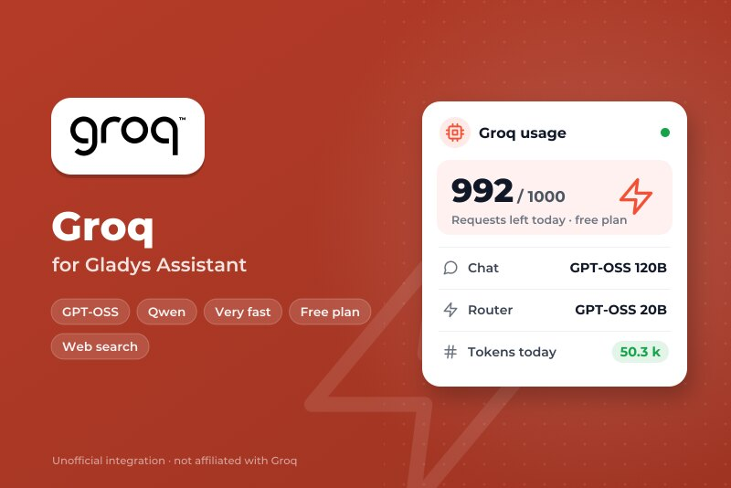
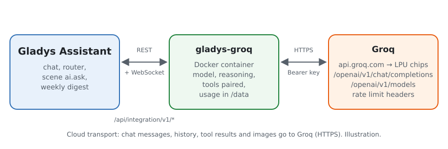
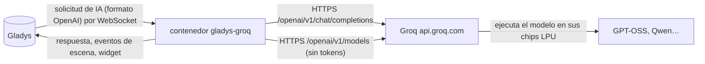
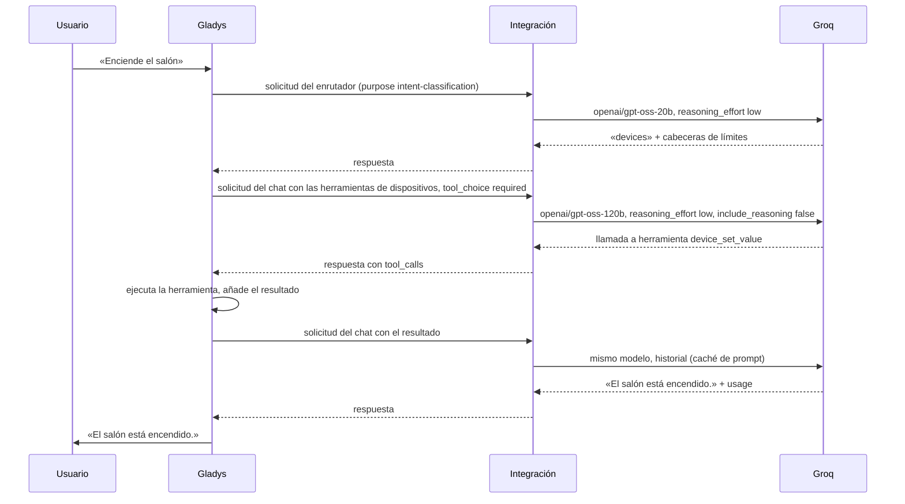
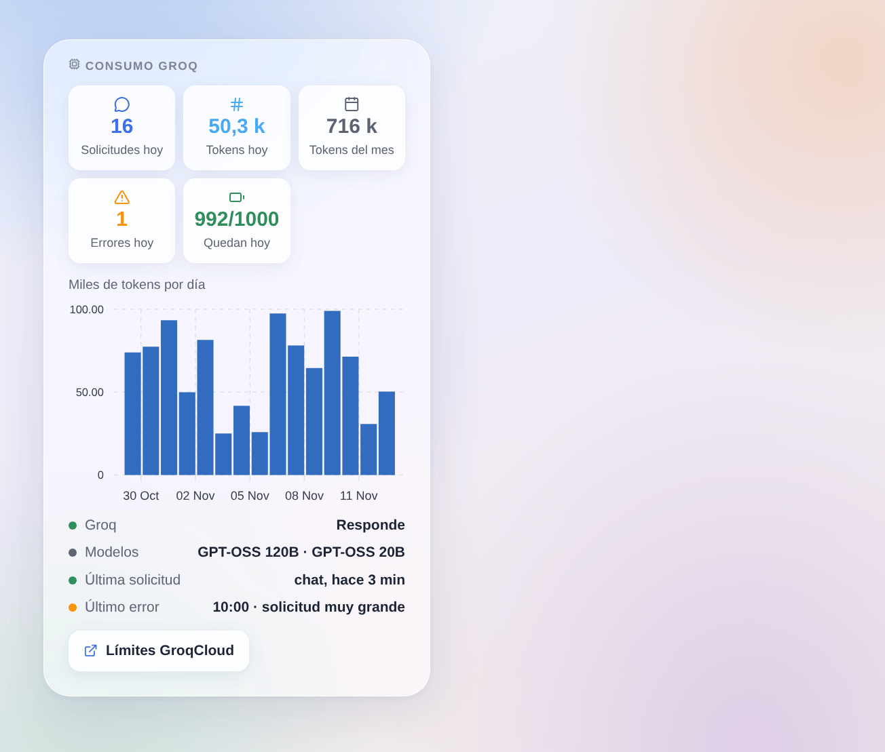

# Gladys Groq

[English](README.md) · [Français](README.fr.md) · [Deutsch](README.de.md) · **Español**

[](LICENSE)
[](https://github.com/William-De71/gladys-groq/releases)
[](https://github.com/William-De71/gladys-groq/actions/workflows/release.yml)
[](https://gladysassistant.com)



Integración externa de [Gladys Assistant](https://gladysassistant.com) que ejecuta el asistente de Gladys en **Groq**: modelos abiertos (OpenAI GPT-OSS, Qwen) servidos por los chips LPU propios de Groq, varias veces más rápido de lo habitual, de modo que el asistente responde casi al instante. Una vez elegida en Ajustes → Inteligencia artificial, el modelo que elija responde al chat, controla sus dispositivos, crea escenas, responde a la acción de escena «preguntar a la IA» y redacta el resumen semanal — con una clave gratuita de Groq, con o sin cuenta Gladys Plus.

Documentación de usuario: [English](docs/en.md) · [Français](docs/fr.md) · [Deutsch](docs/de.md) · [Español](docs/es.md).

Sin relación con Groq. **Todavía no probada con una clave real de Groq**: las solicitudes siguen la referencia oficial de la API de Groq y las pruebas se ejecutan contra una API simulada. Se agradecen los comentarios.

## Funciones

- **Proveedor de IA** (`type: "ai"`, Gladys 5.3+): todas las solicitudes de IA de Gladys van a Groq — el chat con sus llamadas a herramientas, el enrutador de intenciones, la acción de escena «preguntar a la IA», el resumen semanal.
- **Dos modelos**: un modelo de chat (GPT-OSS 120B por defecto) y un modelo de enrutador (GPT-OSS 20B, menos de un segundo), entre GPT-OSS 120B, GPT-OSS 20B, Qwen 3.8 27B (lee las imágenes del chat) o cualquier otro identificador de modelo de Groq.
- **Nivel de razonamiento** del modelo de chat (desactivado, bajo, medio, alto), adaptado a lo que acepta cada modelo; **nivel de servicio** (bajo demanda, auto, flex).
- **Pensada para el plan gratuito**: las solicitudes que quedan hoy vienen de las cabeceras de límites de Groq; una solicitud mayor que los tokens por minuto del plan se nombra como tal, sin reintentos inútiles.
- **Acción de escena «preguntar con búsqueda web»**: GPT-OSS busca en la web con la búsqueda integrada de Groq y responde brevemente (noticias, tráfico, un evento); la respuesta y las fuentes son salidas para las acciones siguientes.
- **Disparadores de escena**: el asistente falla (clave rechazada, límite de gasto, límite de solicitudes, solicitud demasiado grande para el plan, modelo no disponible, API inaccesible) y vuelve a responder — una vez por fallo.
- **Widget del panel**: solicitudes, tokens del día y del mes, solicitudes que quedan hoy, tokens por día durante 30 días, última respuesta y último error.
- Botón **Probar la conexión**; la pantalla de configuración indica si Groq acepta la clave y conoce los modelos, sin gastar nada.
- Inglés, francés, alemán y español.

## Funcionamiento





Todo el bucle agéntico (prompts, herramientas, historial, redimensionado de imágenes) sigue en Gladys; la integración elige el modelo y prepara cada solicitud y su respuesta:



Lo que gestiona la integración: llamadas a herramientas y resultados siempre emparejados (los identificadores que Gladys escribe para llamadas sin él, como `unknown`, reciben uno estable; una llamada sola recibe un resultado de sustitución), el nivel de razonamiento más cercano a lo que acepta cada modelo (GPT-OSS no puede desactivarlo), el razonamiento fuera del historial como aconseja Groq, un nuevo intento cuando Groq rechaza una llamada a herramienta no válida escrita por el modelo (`tool_use_failed`), y los límites que Gladys impone a una respuesta. Un 429, un 498 (nivel flex saturado) o un 5xx se reintenta mientras el tiempo de espera del núcleo lo permita (18 s para el enrutador, 110 s para el chat); un límite diario o una solicitud demasiado grande para el plan falla al momento con su motivo.

### Transporte

`transports: ["cloud"]`: todo va a `api.groq.com` por HTTPS. **Groq ve cada mensaje del chat, el historial, las definiciones y resultados de las herramientas (el estado de los dispositivos que consulta el asistente) y las imágenes del chat**, y las respuestas controlan sus dispositivos y escenas. Gladys nunca vuelve a Gladys Plus cuando Groq falla: el chat dice qué ocurre. `/data` solo guarda los contadores del widget.

## Modelos

| Opción       | Identificador         | Uso                                                               | Razonamiento       |
| ------------ | --------------------- | ----------------------------------------------------------------- | ------------------ |
| GPT-OSS 120B | `openai/gpt-oss-120b` | Chat (por defecto): el más capaz, búsqueda web, ~500 tokens/s     | bajo a alto        |
| GPT-OSS 20B  | `openai/gpt-oss-20b`  | Enrutador (por defecto) o chat económico, ~1000 tokens/s          | bajo a alto        |
| Qwen 3.8 27B | `qwen/qwen3.8-27b`    | Chat que lee imágenes (modelo en versión preliminar)              | desactivado a alto |
| Otro modelo  | su identificador      | Cualquier modelo de console.groq.com/docs/models con herramientas | según lo pedido    |

Comprobado el 23 de noviembre de 2026. Groq no tiene alias de «última versión»: retira los modelos con aviso ([deprecations](https://console.groq.com/docs/deprecations)); «Otro modelo» admite un sucesor. El estado avisa cuando un modelo elegido no está en la lista de la clave o está en versión preliminar.

## Escenas y widget



- **Acción «Groq: preguntar con búsqueda web»**: campos `question` (se admiten variables de escena), `instructions` (opcional); salidas `answer` y `sources` (una por línea). Usa el modelo del chat cuando es un GPT-OSS, si no GPT-OSS 120B, con la herramienta `browser_search` de Groq (proporcionada por Exa), `reasoning_effort` low. Las páginas leídas cuentan como tokens de entrada: en el plan gratuito, una búsqueda puede gastar los tokens de un minuto entero.
- **Disparador «Groq: el asistente falla»**: variables `kind` (`auth`, `spend_limit`, `rate_limit`, `too_large`, `model`, `unreachable`, `timeout`, `server`), `message`, `use`, `model`; filtro por tipo. Una solicitud rechazada (HTTP 400, un modelo que no lee imágenes) solo afecta a esa solicitud y no dispara nada.
- **Disparador «Groq: el asistente vuelve a responder»**: variable `down_minutes`.
- **Widget «Consumo Groq»**: contado por la integración a partir del `usage` de cada respuesta; las solicitudes hechas fuera de Gladys con la misma organización no están incluidas. Las solicitudes que quedan hoy son las del modelo del chat, de las cabeceras `x-ratelimit-*` de su última respuesta. Groq no da coste por solicitud: la consola de GroqCloud sigue siendo la referencia para la factura.

Ejemplos:

- _Cada mañana a las 7:30_ → **preguntar con búsqueda web** «las tres noticias principales del día en España, en tres frases cortas» → enviar `{{answer}}` por Telegram.
- _Cuando el asistente falla_ (tipo `rate_limit`) → enviar un mensaje al administrador: «límite de Groq alcanzado».
- _Antes de salir_ → **preguntar con búsqueda web** «tráfico en la A-7 entre Málaga y Marbella ahora» → decir la respuesta en el altavoz de la entrada.

## Requisitos

- Gladys Assistant **5.3.0** o posterior (proveedores de IA); las instancias más antiguas no pueden instalar la integración.
- Una cuenta de GroqCloud y una clave de API de [console.groq.com/keys](https://console.groq.com/keys) (gratuita, sin tarjeta).

### Planes y límites

- **Plan gratuito**: por modelo, unas 30 solicitudes por minuto, 1000 al día y 8000 tokens por minuto (valores exactos en [console.groq.com/settings/limits](https://console.groq.com/settings/limits)). Un intercambio del chat hace al menos dos solicitudes (enrutador y luego chat), más cuando se llaman herramientas. Una solicitud cuyo prompt más el presupuesto de respuesta supera los tokens de un minuto se rechaza (HTTP 413): mantenga baja la longitud máxima de respuesta; los tokens servidos desde la caché de prompt no cuentan.
- **Plan Developer**: pago por uso (GPT-OSS 120B: 0,15 $ por millón de tokens de entrada, 0,60 $ de salida; GPT-OSS 20B la mitad), límites mucho más altos, nivel flex. Un límite de gasto (Settings → Billing → Limits) pone tope a la factura.

## Instalación

- **Desde la tienda**: Integraciones → Groq → Instalar.
- **Desde la URL del repositorio**: Integraciones → integración externa → `https://github.com/William-De71/gladys-groq`.
- **Modo desarrollador**: ejecute `npm start` con las variables que da Gladys (ver Desarrollo).

## Configuración

| Campo o botón                 | Por defecto  | Significado                                                                    |
| ----------------------------- | ------------ | ------------------------------------------------------------------------------ |
| Clave de API de Groq          | —            | Obligatoria, secreta: nunca se vuelve a mostrar ni se registra                 |
| Modelo del chat               | GPT-OSS 120B | Chat, creación de escenas, resumen semanal, acción de búsqueda web             |
| Modelo del enrutador          | GPT-OSS 20B  | Clasifica cada mensaje antes de la respuesta, en menos de 20 s                 |
| Identificador del otro modelo | —            | Se usa cuando un modelo está en «Otro modelo»                                  |
| Razonamiento                  | bajo         | Del modelo del chat; el enrutador recibe el nivel más bajo de su modelo        |
| Longitud máxima de respuesta  | 4096 tokens  | Razonamiento incluido; cuenta en los tokens por minuto del plan gratuito       |
| Nivel de servicio             | Bajo demanda | O auto, o flex (de pago: límites altos, falla al momento si está saturado)     |
| Probar la conexión            | —            | Una respuesta corta de cada modelo, con su tiempo y las solicitudes que quedan |

## Uso

1. En Gladys (Integraciones → Groq → Configuración): pegue la clave de API, elija los modelos; pulse **Probar la conexión**.
2. Ajustes → **Inteligencia artificial**: elija **Groq** como proveedor.
3. Hable con Gladys en el chat; añada el widget a un panel; use los disparadores y la acción de búsqueda web en sus escenas.

## Desarrollo

```bash
npm install
npm test                       # node --test, una API de Groq simulada en 127.0.0.1, nunca la red
npm run lint                   # ESLint
npm run format:check           # Prettier
npx github:GladysAssistant/integration-store . --skip-image-check
scripts/build-cover.sh         # cover.jpg a partir de docs/assets/cover.svg
docs/illustrations/render.sh   # docs/assets/widgets.<idioma>.png
```

En local, el SDK lee `GLADYS_HOST_API_URL`, `GLADYS_INTEGRATION_TOKEN` y `GLADYS_INTEGRATION_SELECTOR` (que Gladys da en modo desarrollador), y la integración lee `TZ`. `DEBUG=gladys-integration-sdk` muestra los registros del SDK.

Las pruebas cubren el cliente HTTP (errores, cabeceras de límites, reintentos, plazos), la lista de modelos, la conversión en ambos sentidos (`validateAiCompletion` del SDK, emparejamiento), el gestor del chat (modelo por uso, razonamiento, nivel de servicio, parámetro rechazado, llamada a herramienta no válida), la búsqueda web, los disparadores, los contadores, el widget (`validateWidgetContent`), el manifiesto, los cuatro idiomas, el script de publicación y toda la integración contra el Gladys simulado del SDK. `test/structure.test.js` congela cada clave que guardan los usuarios.

## Proceso de publicación


Cada fusión en `main` ejecuta la CI y luego calcula la versión a partir de los [Conventional Commits](https://www.conventionalcommits.org/es/) desde la última etiqueta: `feat` → menor, `fix` / `perf` → parche, `!` o `BREAKING CHANGE` → mayor (una menor por debajo de 1.0.0); `docs`, `chore`, `ci`, `test`, `style`, `refactor`, `build` solos no publican nada. Se genera la sección del changelog, se sube la etiqueta, se construye la imagen multiarquitectura, luego `main` recibe el commit de publicación, se crea la GitHub Release y un último job comprueba la imagen pública, el validador de la tienda y el topic.

- El título de la pull request se convierte en el commit squash y luego en la línea del changelog: escríbalo en inglés, para el usuario (`pr-title.yml` lo comprueba). No edite nunca `CHANGELOG.md` a mano.
- La 1.0.0 es una decisión: Actions → Release → Run workflow con `release-as: 1.0.0`. `dry-run` muestra la versión y las notas sin publicar.
- **Rama protegida**: la publicación sube su commit a `main` con `GITHUB_TOKEN`. El ruleset `protect-main` (sin borrado, sin force-push) lo deja pasar; una regla más estricta (pull request obligatoria, status checks) necesitaría GitHub Actions en su lista de excepciones, o una GitHub App.
- Tras la primera publicación, haga público el paquete de `ghcr.io` (Package settings → Change visibility), o Gladys no podrá descargarlo.

## Solución de problemas

Ver [docs/es.md](docs/es.md#solución-de-problemas). Informe de los problemas con las versiones de Gladys y de la integración, los modelos elegidos, el plan (gratuito o Developer) y el mensaje de **Probar la conexión**. No pegue nunca su clave de API.

## Contribuir

Las issues y pull requests son bienvenidas, sobre todo de personas con una clave de Groq: una solicitud que falla (sin la clave) ayuda mucho. Ejecute `npm run format:check && npm run lint && npm test` antes de abrir una pull request y no cambie ninguna clave guardada (ver [CLAUDE.md](CLAUDE.md)).

## Seguridad

Ver [SECURITY.md](SECURITY.md): informe de las vulnerabilidades en privado. La clave de API es un campo `secret`: nunca se registra, nunca se escribe en `/data`, solo se envía a `api.groq.com` por HTTPS.

## Capturas pendientes

Las imágenes de arriba son ilustraciones, no capturas de pantalla. Las capturas reales irán en `docs/assets/screenshots/` (PNG, 1280 × 800): `configuration.png` (la configuración con su estado), `ai-settings.png` (Groq elegido en Ajustes → Inteligencia artificial), `chat.png` (un chat que enciende un dispositivo), `scene-web-search.png` (la acción de búsqueda web en una escena).

## Licencia

[Licencia Apache 2.0](LICENSE) — ver también [NOTICE](NOTICE). Groq es una marca de Groq, Inc.; los nombres de los modelos pertenecen a sus propietarios. Este proyecto no está afiliado a Groq ni respaldado o patrocinado por Groq. Gracias a la documentación y al SDK de Gladys, y a la documentación de Groq.
