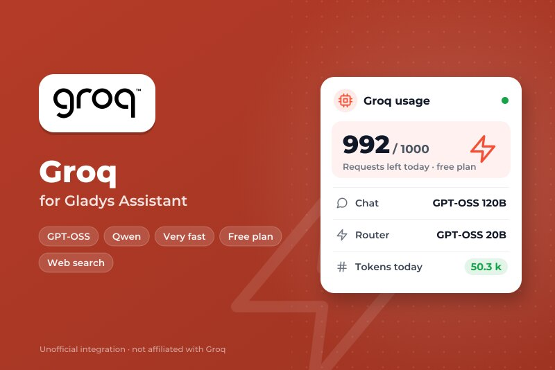
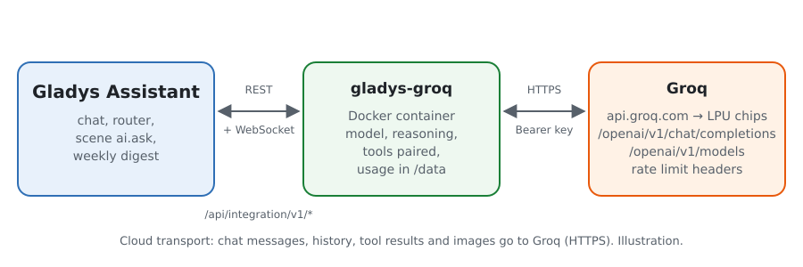
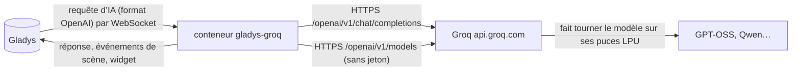
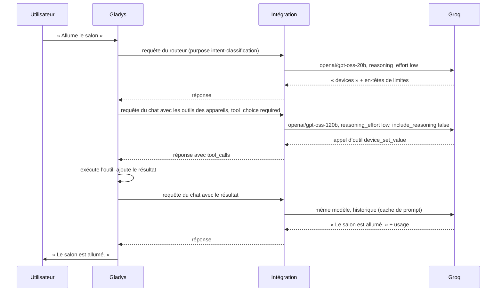
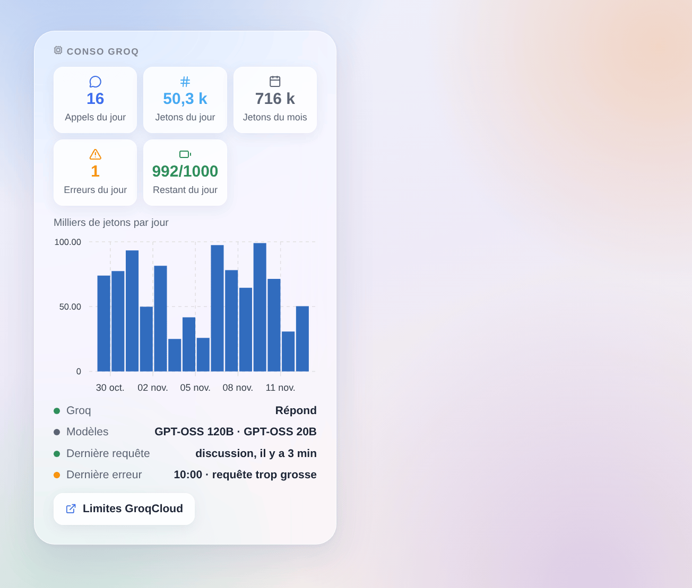

# Gladys Groq

[English](README.md) · **Français** · [Deutsch](README.de.md) · [Español](README.es.md)

[](LICENSE)
[](https://github.com/William-De71/gladys-groq/releases)
[](https://github.com/William-De71/gladys-groq/actions/workflows/release.yml)
[](https://gladysassistant.com)



Intégration externe de [Gladys Assistant](https://gladysassistant.com) qui fait tourner l’assistant de Gladys sur **Groq** : des modèles ouverts (OpenAI GPT-OSS, Qwen) servis par les puces LPU de Groq, plusieurs fois plus vite que d’habitude, si bien que l’assistant répond presque aussitôt. Une fois choisie dans Paramètres → Intelligence artificielle, le modèle de votre choix répond au chat, pilote vos appareils, crée des scènes, répond à l’action de scène « demander à l’IA » et rédige le résumé hebdomadaire — avec une clé Groq gratuite, avec ou sans compte Gladys Plus.

Documentation utilisateur : [English](docs/en.md) · [Français](docs/fr.md) · [Deutsch](docs/de.md) · [Español](docs/es.md).

Sans lien avec Groq. **Pas encore testée avec une vraie clé Groq** : les requêtes suivent la référence officielle de l’API de Groq, et les tests tournent contre une fausse API. Les retours sont bienvenus.

## Fonctionnalités

- **Fournisseur d’IA** (`type: "ai"`, Gladys 5.3+) : toutes les requêtes d’IA de Gladys vont à Groq — le chat et ses appels d’outils, le routeur d’intentions, l’action de scène « demander à l’IA », le résumé hebdomadaire.
- **Deux modèles** : un modèle de chat (GPT-OSS 120B par défaut) et un modèle de routeur (GPT-OSS 20B, moins d’une seconde), parmi GPT-OSS 120B, GPT-OSS 20B, Qwen 3.8 27B (lit les images du chat) ou tout autre identifiant de modèle Groq.
- **Niveau de réflexion** du modèle de chat (désactivée, faible, moyenne, élevée), adapté à ce que chaque modèle accepte ; **niveau de service** (à la demande, auto, flex).
- **Pensée pour l’offre gratuite** : les requêtes restantes du jour viennent des en-têtes de limites de Groq ; une requête plus grosse que les jetons par minute de l’offre est nommée comme telle, sans nouvel essai inutile.
- **Action de scène « demander avec recherche web »** : GPT-OSS cherche sur le web avec la recherche intégrée de Groq et répond brièvement (actualités, trafic, un événement) ; la réponse et les sources sont des sorties pour les actions suivantes.
- **Déclencheurs de scène** : l’assistant est en erreur (clé refusée, limite de dépense, limite de requêtes, requête trop grosse pour l’offre, modèle indisponible, API injoignable) et répond de nouveau — une fois par panne.
- **Widget de tableau de bord** : requêtes, jetons du jour et du mois, requêtes restantes du jour, jetons par jour sur 30 jours, dernière réponse et dernière erreur.
- Bouton **Tester la connexion** ; l’écran de configuration indique si Groq accepte la clé et connaît les modèles, sans rien dépenser.
- Anglais, français, allemand et espagnol.

## Fonctionnement





Toute la boucle agentique (prompts, outils, historique, redimensionnement des images) reste dans Gladys ; l’intégration choisit le modèle et prépare chaque requête et sa réponse :



Ce que l’intégration gère : appels d’outils et résultats toujours appariés (les identifiants que Gladys écrit pour un appel qui n’en a pas, comme `unknown`, en reçoivent un stable ; un appel seul reçoit un résultat de remplacement), le niveau de réflexion le plus proche de ce que chaque modèle accepte (GPT-OSS ne peut pas la couper), la réflexion tenue hors de l’historique comme Groq le conseille, un nouvel essai quand Groq refuse un appel d’outil invalide écrit par le modèle (`tool_use_failed`), et les bornes que Gladys impose à une réponse. Un 429, un 498 (niveau flex saturé) ou un 5xx est retenté tant que le délai d’attente du cœur le permet (18 s pour le routeur, 110 s pour le chat) ; une limite journalière ou une requête trop grosse pour l’offre échoue aussitôt avec sa raison.

### Transport

`transports: ["cloud"]` : tout part vers `api.groq.com` en HTTPS. **Groq voit chaque message du chat, l’historique, les définitions et résultats des outils (l’état des appareils que l’assistant consulte) et les images du chat**, et les réponses pilotent vos appareils et vos scènes. Gladys ne revient jamais à Gladys Plus quand Groq échoue : le chat dit ce qui ne va pas. `/data` ne garde que les compteurs du widget.

## Modèles

| Choix        | Identifiant           | Usage                                                           | Réflexion           |
| ------------ | --------------------- | --------------------------------------------------------------- | ------------------- |
| GPT-OSS 120B | `openai/gpt-oss-120b` | Chat (défaut) : le plus capable, recherche web, ~500 jetons/s   | faible à élevée     |
| GPT-OSS 20B  | `openai/gpt-oss-20b`  | Routeur (défaut) ou chat économique, ~1 000 jetons/s            | faible à élevée     |
| Qwen 3.8 27B | `qwen/qwen3.8-27b`    | Chat qui lit les images (modèle en préversion)                  | désactivée à élevée |
| Autre modèle | votre identifiant     | Tout modèle de console.groq.com/docs/models qui sait les outils | comme demandé       |

Vérifié le 23 novembre 2026. Groq n’a pas d’alias « dernière version » : il retire les modèles avec préavis ([deprecations](https://console.groq.com/docs/deprecations)) ; « Autre modèle » accueille un successeur. Le statut prévient quand un modèle choisi n’est pas dans la liste de la clé, ou est en préversion.

## Scènes et widget



- **Action « Groq : demander avec recherche web »** : champs `question` (variables de scène acceptées), `instructions` (facultatif) ; sorties `answer` et `sources` (une par ligne). Utilise le modèle du chat quand c’est un GPT-OSS, sinon GPT-OSS 120B, avec l’outil `browser_search` de Groq (fourni par Exa), `reasoning_effort` low. Les pages lues comptent en jetons d’entrée : avec l’offre gratuite, une recherche peut consommer les jetons d’une minute entière.
- **Déclencheur « Groq : l’assistant est en erreur »** : variables `kind` (`auth`, `spend_limit`, `rate_limit`, `too_large`, `model`, `unreachable`, `timeout`, `server`), `message`, `use`, `model` ; filtre par type. Une requête refusée (HTTP 400, modèle qui ne lit pas les images) ne concerne qu’elle et ne déclenche rien.
- **Déclencheur « Groq : l’assistant répond de nouveau »** : variable `down_minutes`.
- **Widget « Conso Groq »** : compté par l’intégration à partir de l’`usage` de chaque réponse ; les requêtes faites hors de Gladys avec la même organisation n’y sont pas. Les requêtes restantes du jour sont celles du modèle du chat, tirées des en-têtes `x-ratelimit-*` de sa dernière réponse. Groq ne donne pas de coût par requête : la console GroqCloud reste la référence pour la facture.

Exemples :

- _Chaque matin à 7 h 30_ → **demander avec recherche web** « les trois principales actualités du jour en France, en trois phrases courtes » → envoyer `{{answer}}` par Telegram.
- _Quand l’assistant est en erreur_ (type `rate_limit`) → envoyer un message à l’administrateur : « limite Groq atteinte ».
- _Avant de partir_ → **demander avec recherche web** « trafic sur l’A7 entre Lyon et Valence en ce moment » → dire la réponse sur l’enceinte de l’entrée.

## Prérequis

- Gladys Assistant **5.3.0** ou plus récent (fournisseurs d’IA) ; les instances plus anciennes ne peuvent pas installer l’intégration.
- Un compte GroqCloud et une clé d’API sur [console.groq.com/keys](https://console.groq.com/keys) (gratuite, sans carte).

### Offres et limites

- **Offre gratuite** : par modèle, environ 30 requêtes par minute, 1 000 par jour et 8 000 jetons par minute (valeurs exactes sur [console.groq.com/settings/limits](https://console.groq.com/settings/limits)). Un échange du chat fait au moins deux requêtes (routeur, puis chat), plus quand des outils sont appelés. Une requête dont le prompt plus le budget de réponse dépasse les jetons d’une minute est refusée (HTTP 413) : gardez la longueur maximale d’une réponse basse ; les jetons servis par le cache de prompt ne comptent pas.
- **Offre Developer** : paiement à l’usage (GPT-OSS 120B : 0,15 $ par million de jetons en entrée, 0,60 $ en sortie ; GPT-OSS 20B moitié moins), limites bien plus hautes, niveau flex. Une limite de dépense (Settings → Billing → Limits) plafonne la facture.

## Installation

- **Depuis le store** : Intégrations → Groq → Installer.
- **Depuis l’URL du dépôt** : Intégrations → intégration externe → `https://github.com/William-De71/gladys-groq`.
- **Mode développeur** : lancez `npm start` avec les variables fournies par Gladys (voir Développement).

## Configuration

| Champ ou bouton                 | Défaut       | Rôle                                                                          |
| ------------------------------- | ------------ | ----------------------------------------------------------------------------- |
| Clé d’API Groq                  | —            | Obligatoire, secrète : plus jamais affichée, jamais journalisée               |
| Modèle du chat                  | GPT-OSS 120B | Chat, création de scènes, résumé hebdomadaire, action de recherche web        |
| Modèle du routeur               | GPT-OSS 20B  | Trie chaque message avant la réponse, en moins de 20 s                        |
| Identifiant de l’autre modèle   | —            | Utilisé quand un modèle est réglé sur « Autre modèle »                        |
| Réflexion                       | faible       | Du modèle du chat ; le routeur reçoit le niveau le plus bas de son modèle     |
| Longueur maximale d’une réponse | 4096 jetons  | Réflexion comprise ; comptée dans les jetons par minute de l’offre gratuite   |
| Niveau de service               | À la demande | Ou auto, ou flex (offres payantes : limites hautes, échec immédiat si chargé) |
| Tester la connexion             | —            | Une réponse courte de chaque modèle, avec son temps et les requêtes restantes |

## Utilisation

1. Dans Gladys (Intégrations → Groq → Configuration) : collez la clé d’API, choisissez les modèles ; appuyez sur **Tester la connexion**.
2. Paramètres → **Intelligence artificielle** : choisissez **Groq** comme fournisseur.
3. Parlez à Gladys dans le chat ; ajoutez le widget à un tableau de bord ; utilisez les déclencheurs et l’action de recherche web dans vos scènes.

## Développement

```bash
npm install
npm test                       # node --test, une fausse API Groq sur 127.0.0.1, jamais le réseau
npm run lint                   # ESLint
npm run format:check           # Prettier
npx github:GladysAssistant/integration-store . --skip-image-check
scripts/build-cover.sh         # cover.jpg depuis docs/assets/cover.svg
docs/illustrations/render.sh   # docs/assets/widgets.<langue>.png
```

En local, le SDK lit `GLADYS_HOST_API_URL`, `GLADYS_INTEGRATION_TOKEN` et `GLADYS_INTEGRATION_SELECTOR` (fournies par Gladys en mode développeur), et l’intégration lit `TZ`. `DEBUG=gladys-integration-sdk` affiche les journaux du SDK.

Les tests couvrent le client HTTP (erreurs, en-têtes de limites, nouveaux essais, délais), la liste des modèles, la conversion dans les deux sens (`validateAiCompletion` du SDK, appariement), le gestionnaire du chat (modèle par usage, réflexion, niveau de service, paramètre refusé, appel d’outil invalide), la recherche web, les déclencheurs, les compteurs, le widget (`validateWidgetContent`), le manifeste, les quatre langues, le script de release, et toute l’intégration contre le faux Gladys du SDK. `test/structure.test.js` fige chaque clé que les utilisateurs enregistrent.

## Processus de release


Chaque fusion sur `main` lance la CI, puis calcule la version à partir des [Conventional Commits](https://www.conventionalcommits.org/fr/) depuis le dernier tag : `feat` → mineure, `fix` / `perf` → correctif, `!` ou `BREAKING CHANGE` → majeure (une mineure sous 1.0.0) ; `docs`, `chore`, `ci`, `test`, `style`, `refactor`, `build` seuls ne publient rien. La section du changelog est générée, le tag poussé, l’image multi-architecture construite, puis `main` reçoit le commit de release, la GitHub Release est créée et un dernier job vérifie l’image publique, le validateur du store et le topic.

- Le titre de la pull request devient le commit squash, puis la ligne du changelog : écrivez-le en anglais, pour l’utilisateur (`pr-title.yml` le vérifie). N’éditez jamais `CHANGELOG.md` à la main.
- La 1.0.0 est une décision : Actions → Release → Run workflow avec `release-as: 1.0.0`. `dry-run` affiche la version et les notes sans rien publier.
- **Branche protégée** : des rulesets imposent une pull request sur `main` et verrouillent les tags `v*` ; seuls le mainteneur et les deploy keys passent. La release pousse avec la deploy key de l’environnement `release` (secret `RELEASE_DEPLOY_KEY`, `main` seulement) : un run lancé depuis une autre branche ne l’obtient jamais. `build.yml` et `github-release.yml` ne démarrent pas sur un tag : la release les appelle, ou lancez-les à la main (Actions → Run workflow, avec `version` pour l’image) pour terminer une release.
- Après la première release, rendez le paquet `ghcr.io` public (Package settings → Change visibility), sinon Gladys ne peut pas le télécharger.

## Dépannage

Voir [docs/fr.md](docs/fr.md#dépannage). Signalez un problème avec les versions de Gladys et de l’intégration, les modèles choisis, l’offre (gratuite ou Developer) et le message de **Tester la connexion**. Ne collez jamais votre clé d’API.

## Contribuer

Les issues et pull requests sont bienvenues, surtout de la part de personnes qui ont une clé Groq : une requête en échec (sans la clé) aide beaucoup. Lancez `npm run format:check && npm run lint && npm test` avant d’ouvrir une pull request, et ne changez aucune clé enregistrée (voir [CLAUDE.md](CLAUDE.md)).

## Sécurité

Voir [SECURITY.md](SECURITY.md) : signalez les vulnérabilités en privé. La clé d’API est un champ `secret` : jamais journalisée, jamais écrite dans `/data`, envoyée seulement à `api.groq.com` en HTTPS.

## Captures à venir

Les images ci-dessus sont des illustrations, pas des captures d’écran. Les vraies captures iront dans `docs/assets/screenshots/` (PNG, 1280 × 800) : `configuration.png` (la configuration et son statut), `ai-settings.png` (Groq choisi dans Paramètres → Intelligence artificielle), `chat.png` (un chat qui allume un appareil), `scene-web-search.png` (l’action de recherche web dans une scène).

## Licence

[Licence Apache 2.0](LICENSE) — voir aussi [NOTICE](NOTICE). Groq est une marque de Groq, Inc. ; les noms des modèles appartiennent à leurs propriétaires. Ce projet n’est ni affilié à Groq, ni approuvé ou sponsorisé par Groq. Merci à la documentation et au SDK de Gladys, ainsi qu’à la documentation de Groq.
