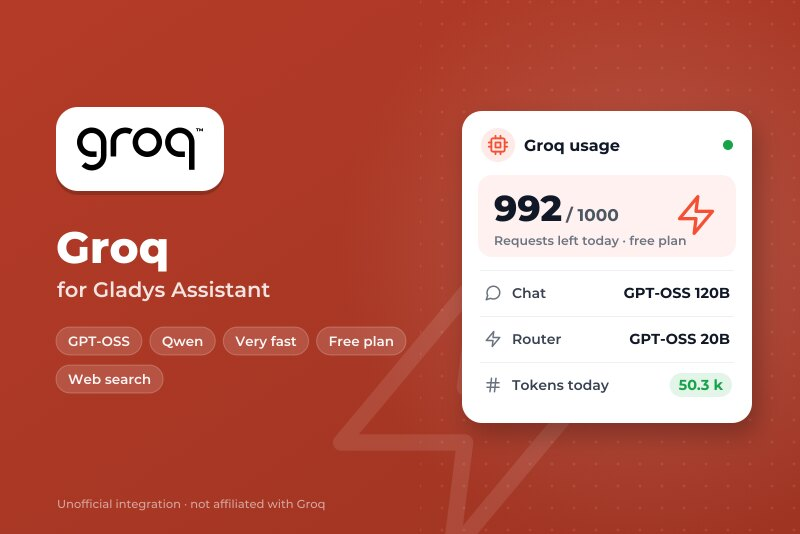
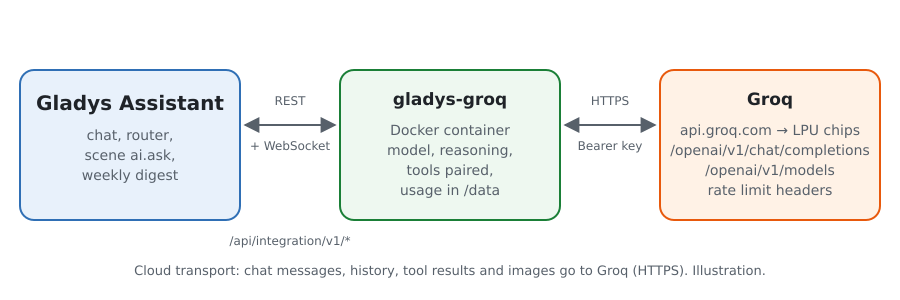
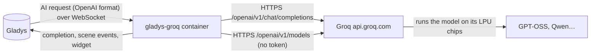
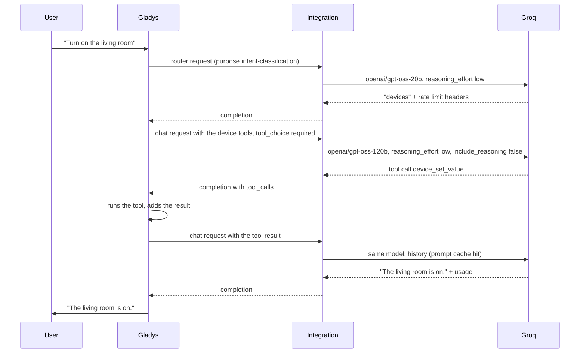
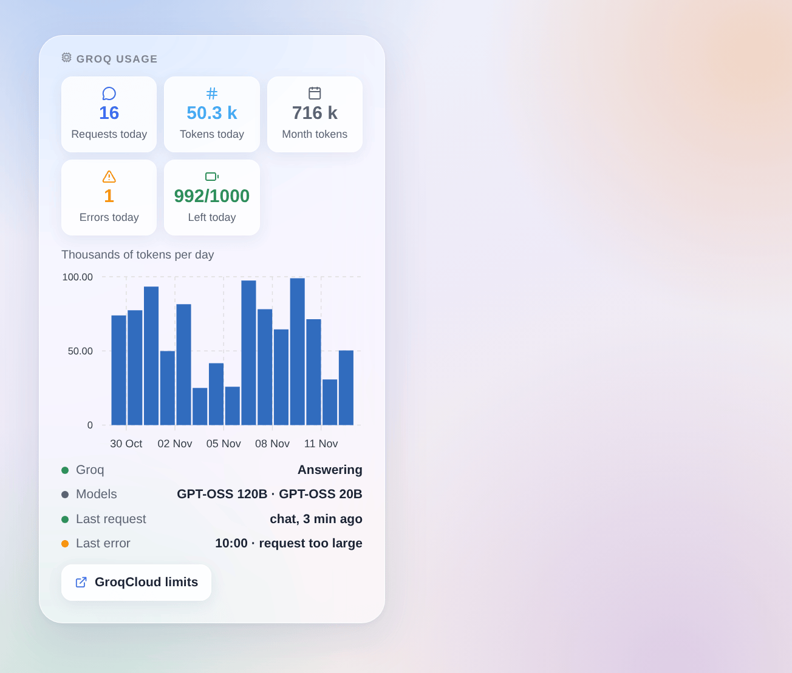

# Gladys Groq

**English** · [Français](README.fr.md) · [Deutsch](README.de.md) · [Español](README.es.md)

[](LICENSE)
[](https://github.com/William-De71/gladys-groq/releases)
[](https://github.com/William-De71/gladys-groq/actions/workflows/release.yml)
[](https://gladysassistant.com)



[Gladys Assistant](https://gladysassistant.com) external integration that runs the assistant of Gladys on **Groq**: open models (OpenAI GPT-OSS, Qwen) served by Groq's own LPU chips, several times faster than usual, so the assistant answers almost at once. Once selected in Settings → Artificial Intelligence, the model you chose answers the chat, controls your devices, creates scenes, answers the "ask the AI" scene action and writes the weekly digest — with a free Groq key, with or without a Gladys Plus account.

User documentation: [English](docs/en.md) · [Français](docs/fr.md) · [Deutsch](docs/de.md) · [Español](docs/es.md).

Not affiliated with Groq. **Not tested with a real Groq key yet**: the requests follow the official API reference of Groq, and the tests run against a fake API. Feedback welcome.

## Features

- **AI provider** (`type: "ai"`, Gladys 5.3+): every AI request of Gladys goes to Groq — the chat with its tool calls, the intent router, the scene "ask the AI" action, the weekly digest.
- **Two models**: a chat model (GPT-OSS 120B by default) and a router model (GPT-OSS 20B, under a second), among GPT-OSS 120B, GPT-OSS 20B, Qwen 3.8 27B (reads the chat images) or any other model id of Groq.
- **Reasoning level** of the chat model (off, low, medium, high), adapted to what each model accepts; **service tier** (on demand, auto, flex).
- **Free plan friendly**: the requests left today come from the rate limit headers of Groq; a request larger than the tokens a minute of the plan is named as such, not retried in vain.
- **Scene action "ask with web search"**: GPT-OSS searches the web with Groq's built-in browser search and answers briefly (news, traffic, an event); the answer and the sources are outputs for the next actions.
- **Scene triggers**: the assistant fails (key refused, spending limit, rate limit, request too large for the plan, model unavailable, API unreachable) and answers again — once per failure.
- **Dashboard widget**: requests, tokens of the day and of the month, requests left today, tokens per day over 30 days, last answer and last error.
- **Test the connection** button; the configuration screen shows whether Groq accepts the key and knows the models, without spending anything.
- English, French, German and Spanish.

## How it works





The whole agentic loop (prompts, tools, history, image resizing) stays in Gladys; the integration picks the model and prepares each request and its answer:



What the integration handles: tool calls and results always paired (the ids Gladys writes for calls without one, such as `unknown`, get stable ones; a lone call gets a placeholder result), the reasoning effort closest to what each model accepts (GPT-OSS cannot turn it off), the reasoning kept out of the history as Groq advises, one more try when Groq refuses an invalid tool call written by the model (`tool_use_failed`), and the bounds Gladys puts on a completion. A 429, a 498 (flex tier busy) or a 5xx is retried while the time the core waits allows it (18 s for the router, 110 s for the chat); a daily limit or a request too large for the plan fails at once with its reason.

### Transport

`transports: ["cloud"]`: everything goes to `api.groq.com` over HTTPS. **Groq sees every chat message, the history, the tool definitions and results (the state of the devices the assistant reads) and the chat images**, and the answers drive your devices and scenes. Gladys never falls back to Gladys Plus when Groq fails: the chat says what is wrong. `/data` only keeps the usage counters of the widget.

## Models

| Choice       | Model id              | Use                                                         | Reasoning   |
| ------------ | --------------------- | ----------------------------------------------------------- | ----------- |
| GPT-OSS 120B | `openai/gpt-oss-120b` | Chat (default): the most capable, web search, ~500 tokens/s | low to high |
| GPT-OSS 20B  | `openai/gpt-oss-20b`  | Router (default) or cheap chat, ~1,000 tokens/s             | low to high |
| Qwen 3.8 27B | `qwen/qwen3.8-27b`    | Chat that reads images (preview model)                      | off to high |
| Other model  | your id               | Any model of console.groq.com/docs/models that uses tools   | as asked    |

Checked on 23 November 2026. Groq has no "latest" aliases: it retires models with notice ([deprecations](https://console.groq.com/docs/deprecations)); "Other model" takes a successor. The status warns when a chosen model is not in the list of the key, or is a preview model.

## Scenes and widget



- **Action "Groq: ask with web search"**: fields `question` (scene variables allowed), `instructions` (optional); outputs `answer` and `sources` (one per line). Uses the chat model when it is a GPT-OSS model, else GPT-OSS 120B, with the `browser_search` tool of Groq (powered by Exa), `reasoning_effort` low. The pages read count as input tokens: on the free plan, a search may use the tokens of a whole minute.
- **Trigger "Groq: the assistant fails"**: variables `kind` (`auth`, `spend_limit`, `rate_limit`, `too_large`, `model`, `unreachable`, `timeout`, `server`), `message`, `use`, `model`; filter by kind. A refused request (HTTP 400, a model that cannot read an image) is about that request only and starts nothing.
- **Trigger "Groq: the assistant answers again"**: variable `down_minutes`.
- **Widget "Groq usage"**: counted by the integration from the `usage` of each answer; requests made outside Gladys with the same organization are not in it. The requests left today are those of the chat model, from the `x-ratelimit-*` headers of its last answer. Groq gives no cost per request: the GroqCloud console stays the reference for the bill.

Examples:

- _Every morning at 7:30_ → **ask with web search** "the three main news of the day in France, in three short sentences" → send `{{answer}}` by Telegram.
- _When the assistant fails_ (kind `rate_limit`) → send a message to the administrator: "Groq limit reached".
- _Before leaving_ → **ask with web search** "traffic on the A7 between Lyon and Valence now" → speak the answer on the speaker of the hall.

## Requirements

- Gladys Assistant **5.3.0** or later (AI providers); older instances cannot install the integration.
- A GroqCloud account and an API key from [console.groq.com/keys](https://console.groq.com/keys) (free, no card).

### Plans and limits

- **Free plan**: per model, about 30 requests a minute, 1,000 a day and 8,000 tokens a minute (exact values on [console.groq.com/settings/limits](https://console.groq.com/settings/limits)). A chat turn makes at least two requests (router, then chat), more when tools are called. A request whose prompt plus answer budget goes over the tokens of a minute is refused (HTTP 413): keep the maximum answer length low; tokens served from the prompt cache do not count.
- **Developer plan**: pay as you go (GPT-OSS 120B: $0.15 per million input tokens, $0.60 output; GPT-OSS 20B half that), much higher limits, the flex tier. A spending limit (Settings → Billing → Limits) caps the bill.

## Installation

- **From the store**: Integrations → Groq → Install.
- **From the repository URL**: Integrations → external integration → `https://github.com/William-De71/gladys-groq`.
- **Developer mode**: run `npm start` with the variables given by Gladys (see Development).

## Configuration

| Field or button       | Default      | Meaning                                                               |
| --------------------- | ------------ | --------------------------------------------------------------------- |
| Groq API key          | —            | Required, a secret: never shown again, never logged                   |
| Chat model            | GPT-OSS 120B | Chat, scene creation, weekly digest, web search action                |
| Router model          | GPT-OSS 20B  | Sorts every message before the answer, within 20 s                    |
| Other model id        | —            | Used when a model is set to "Other model"                             |
| Reasoning             | low          | Of the chat model; the router gets the lowest level its model accepts |
| Maximum answer length | 4096 tokens  | Reasoning included; counted in the tokens a minute of the free plan   |
| Service tier          | On demand    | Or auto, or flex (paid plans: higher limits, fails at once when busy) |
| Test the connection   | —            | One short answer from each model, with its time and the requests left |

## Usage

1. In Gladys (Integrations → Groq → Configuration): paste the API key, choose the models; press **Test the connection**.
2. Settings → **Artificial Intelligence**: choose **Groq** as the provider.
3. Talk to Gladys in the chat; add the widget to a dashboard; use the triggers and the web search action in your scenes.

## Development

```bash
npm install
npm test                       # node --test, a fake Groq API on 127.0.0.1, never the network
npm run lint                   # ESLint
npm run format:check           # Prettier
npx github:GladysAssistant/integration-store . --skip-image-check
scripts/build-cover.sh         # cover.jpg from docs/assets/cover.svg
docs/illustrations/render.sh   # docs/assets/widgets.<lang>.png
```

Locally, the SDK reads `GLADYS_HOST_API_URL`, `GLADYS_INTEGRATION_TOKEN` and `GLADYS_INTEGRATION_SELECTOR` (given by Gladys in developer mode), and the integration reads `TZ`. `DEBUG=gladys-integration-sdk` shows the SDK logs.

The tests cover the HTTP client (errors, rate limit headers, retries, deadlines), the model list, the conversion both ways (`validateAiCompletion` of the SDK, pairing), the chat handler (models per purpose, reasoning, tier, refused parameter, invalid tool call), the web search, the triggers, the usage counters, the widget (`validateWidgetContent`), the manifest, the four languages, the release script, and the whole integration against the fake Gladys of the SDK. `test/structure.test.js` freezes every key users store.

## Release process


Every merge on `main` runs the CI, then computes the version from the [Conventional Commits](https://www.conventionalcommits.org/) since the last tag: `feat` → minor, `fix` / `perf` → patch, `!` or `BREAKING CHANGE` → major (a minor below 1.0.0); `docs`, `chore`, `ci`, `test`, `style`, `refactor`, `build` alone publish nothing. The changelog section is generated, the tag pushed, the multi-architecture image built, then `main` receives the release commit, the GitHub Release is created and a last job checks the public image, the store validator and the topic.

- The pull request title becomes the squash commit, then the changelog line: write it in English, for the user (`pr-title.yml` checks it). Never edit `CHANGELOG.md` by hand.
- 1.0.0 is a decision: Actions → Release → Run workflow with `release-as: 1.0.0`. `dry-run` shows the version and the notes without publishing.
- **Protected branch**: rulesets require a pull request on `main` and lock the `v*` tags; only the maintainer and deploy keys get through. The release pushes with the deploy key of the `release` environment (secret `RELEASE_DEPLOY_KEY`, `main` only): a run from another branch never gets it. `build.yml` and `github-release.yml` do not start on a tag: the release calls them, or run them by hand (Actions → Run workflow, with `version` for the image) to finish a release.
- After the first release, make the `ghcr.io` package public (Package settings → Change visibility), or Gladys cannot pull it.

## Troubleshooting

See [docs/en.md](docs/en.md#troubleshooting). Report issues with the versions of Gladys and of the integration, the models chosen, the plan (free or Developer) and the message of **Test the connection**. Never paste your API key.

## Contributing

Issues and pull requests are welcome, especially from people with a Groq key: a failing request (without the key) helps a lot. Run `npm run format:check && npm run lint && npm test` before opening a pull request, and keep every stored key unchanged (see [CLAUDE.md](CLAUDE.md)).

## Security

See [SECURITY.md](SECURITY.md): report vulnerabilities privately. The API key is a `secret` field: never logged, never written to `/data`, sent only to `api.groq.com` over HTTPS.

## Screenshots to come

The images above are illustrations, not screenshots. Real screenshots will go in `docs/assets/screenshots/` (PNG, 1280 × 800): `configuration.png` (the configuration with its status), `ai-settings.png` (Groq chosen in Settings → Artificial Intelligence), `chat.png` (a chat that switches a device on), `scene-web-search.png` (the web search action in a scene).

## License

[Apache License 2.0](LICENSE) — see also [NOTICE](NOTICE). Groq is a trademark of Groq, Inc.; model names belong to their owners. This project is not affiliated with, endorsed or sponsored by Groq. Thanks to the Gladys documentation and SDK, and to the Groq documentation.
