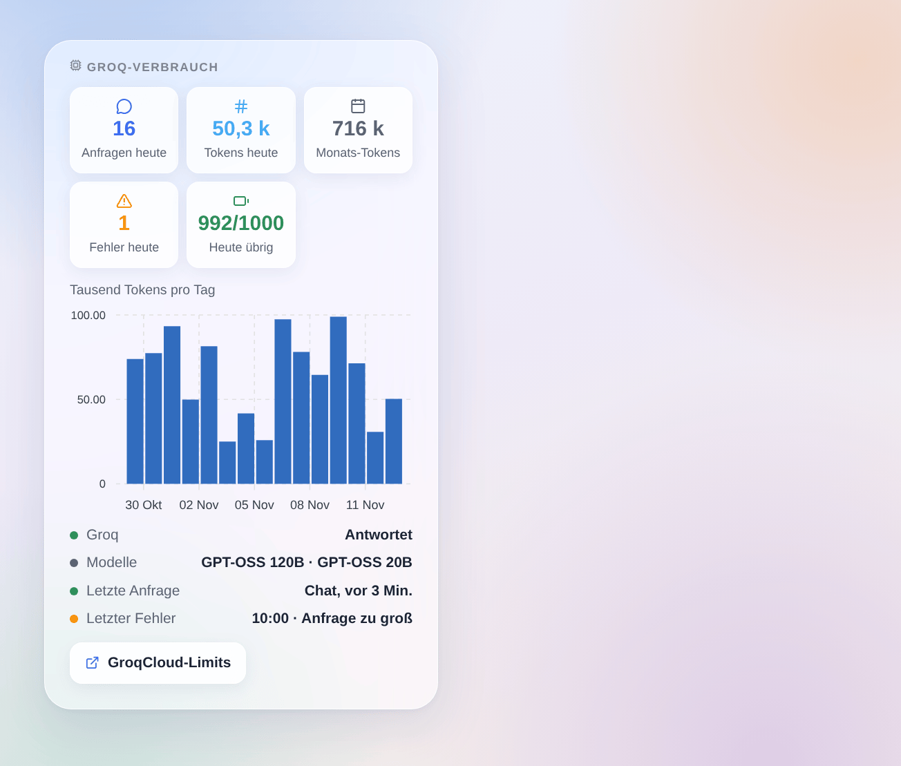

# Groq

## Überblick

Diese Integration lässt den Assistenten von Gladys auf **Groq** laufen, einem Dienst, der offene KI-Modelle (OpenAI GPT-OSS, Qwen) auf eigenen LPU-Chips bereitstellt, um ein Vielfaches schneller als üblich: Der Assistent antwortet fast sofort, was gut zu Sprachbefehlen passt. Sobald du sie unter **Einstellungen → Künstliche Intelligenz** wählst, gehen alle KI-Anfragen von Gladys an Groq: der Chat und die Geräte, die er steuert, die Szenen, die er erstellt, die Szenenaktion „KI fragen“ und der Wochenrückblick. Sie funktioniert mit einem kostenlosen Groq-Schlüssel, mit oder ohne Gladys-Plus-Konto.

Außerdem bringt sie eine Szenenaktion mit, die eine Frage **mit Websuche** stellt, zwei Szenenauslöser (der Assistent hat einen Fehler, der Assistent antwortet wieder) und ein Dashboard-Widget mit den Anfragen, den Tokens und den **heute verbleibenden Anfragen**.

Nicht mit Groq verbunden. Noch nicht mit einem echten Groq-Schlüssel getestet: Rückmeldungen sind willkommen.

## Voraussetzungen

- Gladys Assistant 5.3.0 oder neuer.
- Ein GroqCloud-Konto und ein API-Schlüssel: [console.groq.com/keys](https://console.groq.com/keys) → **Create API Key**. Der kostenlose Tarif braucht keine Karte.
- **Kostenloser Tarif**: pro Modell etwa 30 Anfragen pro Minute, 1.000 pro Tag und 8.000 Tokens pro Minute; deine genauen Limits stehen auf [console.groq.com/settings/limits](https://console.groq.com/settings/limits). Eine Chat-Nachricht macht mindestens zwei Anfragen (Router, dann Chat). Eine Anfrage, deren Prompt plus Antwortbudget die Tokens einer Minute übersteigt, wird abgelehnt: Ein Zuhause mit vielen Geräten kann das erreichen, deshalb ist die maximale Antwortlänge standardmäßig niedrig.
- **Developer-Tarif** (Abrechnung nach Nutzung): GPT-OSS 120B kostet 0,15 $ pro Million Eingabe-Tokens und 0,60 $ pro Million Ausgabe-Tokens, GPT-OSS 20B die Hälfte; die Limits sind viel höher. Ein Ausgabelimit (Settings → Billing → Limits auf console.groq.com) begrenzt die Rechnung.
- Was dein Zuhause verlässt: jede Chat-Nachricht, der Verlauf, die Werkzeuge, die Gladys anbietet, und ihre Ergebnisse (der Zustand der Geräte, die der Assistent liest) sowie die Bilder des Chats gehen per HTTPS an Groq. Die Antworten steuern deine Geräte und erstellen Szenen.

## Konfiguration

| Feld oder Schaltfläche         | Standard     | Bedeutung                                                                                    |
| ------------------------------ | ------------ | -------------------------------------------------------------------------------------------- |
| Groq-API-Schlüssel             | —            | Pflichtfeld (er beginnt mit `gsk_`). Nie wieder angezeigt, nie protokolliert                 |
| Chat-Modell                    | GPT-OSS 120B | Beantwortet den Chat, erstellt Szenen, schreibt den Wochenrückblick                          |
| Router-Modell                  | GPT-OSS 20B  | Sortiert jede Nachricht vor der Antwort und muss innerhalb von 20 Sekunden antworten         |
| ID des anderen Modells         | —            | Nur bei „Anderes Modell“: die genaue ID aus der Groq-Dokumentation (Werkzeuge!)              |
| Nachdenken des Chat-Modells    | Niedrig      | Mehr Nachdenken, bessere Szenen, langsamere Antworten mit mehr Tokens                        |
| Maximale Antwortlänge (Tokens) | 4096         | Nachdenken inklusive; im kostenlosen Tarif zählt sie zu den Tokens der Minute                |
| Service-Stufe                  | Auf Abruf    | Auto: die beste Stufe deiner Organisation. Flex (bezahlt): höhere Limits, scheitert bei Last |
| Verbindung testen              | —            | Eine kurze Antwort jedes Modells mit seiner Zeit und den heute verbleibenden Anfragen        |

Der Status des Konfigurationsbildschirms zeigt, ob Groq den Schlüssel akzeptiert und beide Modelle auflistet, ohne etwas zu verbrauchen, und warnt, wenn ein Vorschaumodell oder die Flex-Stufe gewählt ist.

## Verwendung

1. Integrationen → **Groq** → Konfiguration: API-Schlüssel einfügen, die Standardmodelle behalten, **Verbindung testen** drücken.
2. Einstellungen → **Künstliche Intelligenz**: **Groq** wählen.
3. Mit Gladys im Chat sprechen: „schalte das Wohnzimmer ein“, „wie warm ist es im Schlafzimmer?“, „erstelle eine Szene, die bei Sonnenuntergang die Rollläden schließt“.

### Modelle wählen

- **GPT-OSS 120B** (Standard für den Chat): das größte offene Modell von OpenAI, zuverlässig mit Werkzeugen, etwa 500 Tokens pro Sekunde.
- **GPT-OSS 20B** (Standard für den Router): doppelt so schnell und halb so teuer; auch ein gutes Chat-Modell für ein kleines Zuhause.
- **Qwen 3.8 27B**: liest die Bilder des Chats und kann ohne Nachdenken antworten; ein Vorschaumodell, das Groq kurzfristig entfernen kann.
- **Anderes Modell**: jede ID von [console.groq.com/docs/models](https://console.groq.com/docs/models), die Werkzeuge unterstützt, etwa der Nachfolger eines eingestellten Modells.

GPT-OSS denkt immer ein wenig nach: Die Stufe „Aus“ ergibt bei ihm die niedrige. Lehnt ein anderes Modell den Nachdenk-Parameter ab, sendet die Integration ihn ab dann nicht mehr.

### Dashboard-Widget

Das Widget **Groq-Verbrauch** zeigt die Anfragen, die Tokens und die Fehler des Tages, die Tokens des Monats, die Anfragen, die dem Chat-Modell heute bleiben (nach den Limits, die Groq mit jeder Antwort sendet), die Tokens pro Tag über 30 Tage, ob Groq antwortet, die Modelle, die letzte Anfrage und den letzten Fehler. Groq nennt keine Kosten pro Anfrage: Die GroqCloud-Konsole bleibt die Referenz für die Rechnung.

### Szenen

- **Aktion „Groq: mit Websuche fragen“**: GPT-OSS sucht mit der in Groq eingebauten Browsersuche im Web und antwortet in wenigen Sätzen. Felder: die Frage (Szenenvariablen erlaubt), zusätzliche Anweisungen. Ausgaben: die Antwort und die Quellen, eine pro Zeile. Die gelesenen Seiten zählen als Tokens: Im kostenlosen Tarif kann eine Suche die Tokens einer Minute verbrauchen.
- **Auslöser „Groq: Der Assistent hat einen Fehler“**: einmal pro Ausfall (Schlüssel abgelehnt, Ausgabelimit, Anfragelimit, Anfrage zu groß für den Tarif, Modell nicht verfügbar, API nicht erreichbar, zu langsam, Groq-Fehler), mit Art, Meldung, Anfrage und Modell.
- **Auslöser „Groq: Der Assistent antwortet wieder“**: die erste Antwort nach einem Ausfall, mit den Minuten des Ausfalls.

Beispiele: jeden Morgen mit Websuche nach den Nachrichten des Tages fragen und die Antwort per Telegram senden; wenn der Assistent wegen eines Anfragelimits ausfällt, dem Administrator eine Nachricht senden.

## Fehlerbehebung

- **„Groq hat den API-Schlüssel abgelehnt“**: Kopiere den Schlüssel erneut von console.groq.com/keys; ein gelöschter Schlüssel ergibt dieselbe Meldung.
- **„Eine Anfrage des Assistenten ist größer als die Tokens pro Minute“**: Senke die maximale Antwortlänge (2048 reicht oft), wähle GPT-OSS 20B oder wechsle zum Developer-Tarif.
- **„Groq-Limit erreicht“**: Die Anfragen oder Tokens der Minute oder des Tages sind verbraucht. Warte oder wechsle zum Developer-Tarif.
- **„Das Ausgabelimit der Groq-Organisation ist erreicht“**: Erhöhe es auf console.groq.com oder warte bis zum 1. des Monats.
- **„… ist für diesen Groq-Schlüssel nicht verfügbar“**: Die Modell-ID ist falsch, das Modell wurde eingestellt oder das Projekt sperrt es (Modellberechtigungen).
- **„cannot read images“**: Wähle Qwen 3.8 27B als Chat-Modell.
- **„The answer was cut at max_tokens“**: Erhöhe die maximale Antwortlänge.
- Protokolle: Einstellungen → Supervision, die Protokolle der Integration. Teile nie deinen API-Schlüssel.
