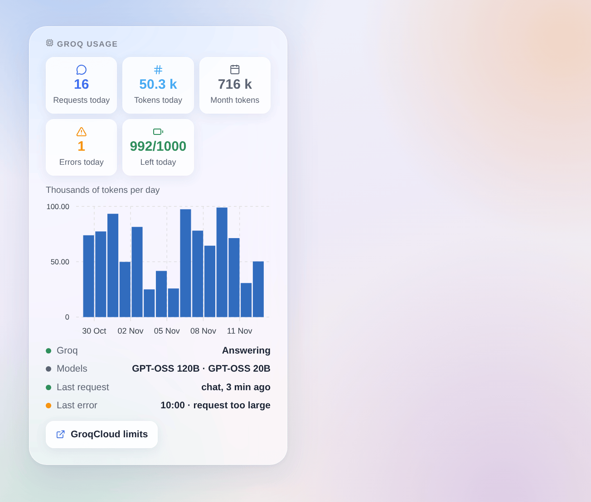

# Groq

## Overview

This integration runs the assistant of Gladys on **Groq**, a service that serves open AI models (OpenAI GPT-OSS, Qwen) on its own LPU chips, several times faster than usual: the assistant answers almost at once, which suits voice commands. Once you choose it in **Settings → Artificial Intelligence**, every AI request of Gladys goes to Groq: the chat and the devices it controls, the scenes it creates, the "ask the AI" scene action and the weekly digest. It works with a free Groq key, with or without a Gladys Plus account.

It also adds a scene action that asks a question **with web search**, two scene triggers (the assistant fails, the assistant answers again) and a dashboard widget with the requests, the tokens and the **requests left today**.

Not affiliated with Groq. Not tested with a real Groq key yet: feedback welcome.

## Prerequisites

- Gladys Assistant 5.3.0 or later.
- A GroqCloud account and an API key: [console.groq.com/keys](https://console.groq.com/keys) → **Create API Key**. The free plan needs no card.
- **Free plan**: per model, about 30 requests a minute, 1,000 a day and 8,000 tokens a minute; your exact limits are on [console.groq.com/settings/limits](https://console.groq.com/settings/limits). A chat message makes at least two requests (router, then chat). A request whose prompt plus answer budget goes over the tokens of a minute is refused: a home with many devices may hit it, which is why the maximum answer length is low by default.
- **Developer plan** (pay as you go): GPT-OSS 120B costs $0.15 per million input tokens and $0.60 per million output tokens, GPT-OSS 20B half that; the limits are much higher. A spending limit (Settings → Billing → Limits on console.groq.com) caps the bill.
- What leaves your home: every chat message, the history, the tools Gladys offers and their results (the state of the devices the assistant reads) and the chat images go to Groq over HTTPS. The answers control your devices and create scenes.

## Configuration

| Field or button                | Default      | Meaning                                                                               |
| ------------------------------ | ------------ | ------------------------------------------------------------------------------------- |
| Groq API key                   | —            | Required (it starts with `gsk_`). Never shown again, never logged                     |
| Chat model                     | GPT-OSS 120B | Answers the chat, creates scenes, writes the weekly digest                            |
| Router model                   | GPT-OSS 20B  | Sorts every message before the answer and must reply within 20 seconds                |
| Other model id                 | —            | Only when a model is set to "Other model": the exact id from the Groq docs (tools!)   |
| Reasoning of the chat model    | Low          | More reasoning, better scenes, slower answers that use more tokens                    |
| Maximum answer length (tokens) | 4096         | Reasoning included; on the free plan it counts in the tokens of the minute            |
| Service tier                   | On demand    | Auto: the best tier of your organization. Flex (paid): higher limits, fails when busy |
| Test the connection            | —            | One short answer from each model with its time and the requests left today            |

The status of the configuration screen says whether Groq accepts the key and lists both models, without spending anything, and warns when a preview model or the flex tier is chosen.

## Usage

1. Integrations → **Groq** → Configuration: paste the API key, keep the default models, press **Test the connection**.
2. Settings → **Artificial Intelligence**: choose **Groq**.
3. Talk to Gladys in the chat: "turn on the living room", "what is the temperature in the bedroom?", "create a scene that closes the shutters at sunset".

### Choosing the models

- **GPT-OSS 120B** (default for the chat): OpenAI's largest open model, reliable with tools, about 500 tokens a second.
- **GPT-OSS 20B** (default for the router): twice as fast and half the price; a good chat model too for a small home.
- **Qwen 3.8 27B**: reads the images of the chat and can answer without reasoning; a preview model, which Groq may remove at short notice.
- **Other model**: any id of [console.groq.com/docs/models](https://console.groq.com/docs/models) that supports tools, for example the successor of a retired model.

GPT-OSS always reasons a little: the "Off" level gives it the low one. If a custom model refuses the reasoning parameter, the integration sends it without from then on.

### Dashboard widget

The **Groq usage** widget shows the requests, the tokens and the errors of the day, the tokens of the month, the requests the chat model has left today (from the limits Groq sends with each answer), the tokens per day over 30 days, whether Groq answers, the models, the last request and the last error. Groq gives no cost per request: the GroqCloud console stays the reference for the bill.

### Scenes

- **Action "Groq: ask with web search"**: GPT-OSS searches the web with the browser search built into Groq and answers in a few sentences. Fields: the question (scene variables allowed), extra instructions. Outputs: the answer and the sources, one per line. The pages read count as tokens: on the free plan, one search may use the tokens of a minute.
- **Trigger "Groq: the assistant fails"**: once per failure (key refused, spending limit, rate limit, request too large for the plan, model unavailable, API unreachable, too slow, Groq error), with the kind, the message, the request and the model.
- **Trigger "Groq: the assistant answers again"**: the first answer after a failure, with the minutes of failure.

Examples: every morning, ask with web search for the news of the day and send the answer by Telegram; when the assistant fails because of a rate limit, send a message to the administrator.

## Troubleshooting

- **"Groq refused the API key"**: copy the key again from console.groq.com/keys; a deleted key gives the same message.
- **"A request of the assistant is bigger than the tokens per minute"**: lower the maximum answer length (2048 is often enough), choose GPT-OSS 20B, or move to the Developer plan.
- **"Groq rate limit reached"**: the requests or tokens of the minute or of the day are spent. Wait, or move to the Developer plan.
- **"The spending limit of the Groq organization is reached"**: raise it on console.groq.com, or wait for the 1st of the month.
- **"… is not available to this Groq key"**: the model id is wrong, the model was retired, or the project blocks it (model permissions).
- **"cannot read images"**: choose Qwen 3.8 27B as the chat model.
- **"The answer was cut at max_tokens"**: raise the maximum answer length.
- Logs: Settings → Supervision, the logs of the integration. Never share your API key.
