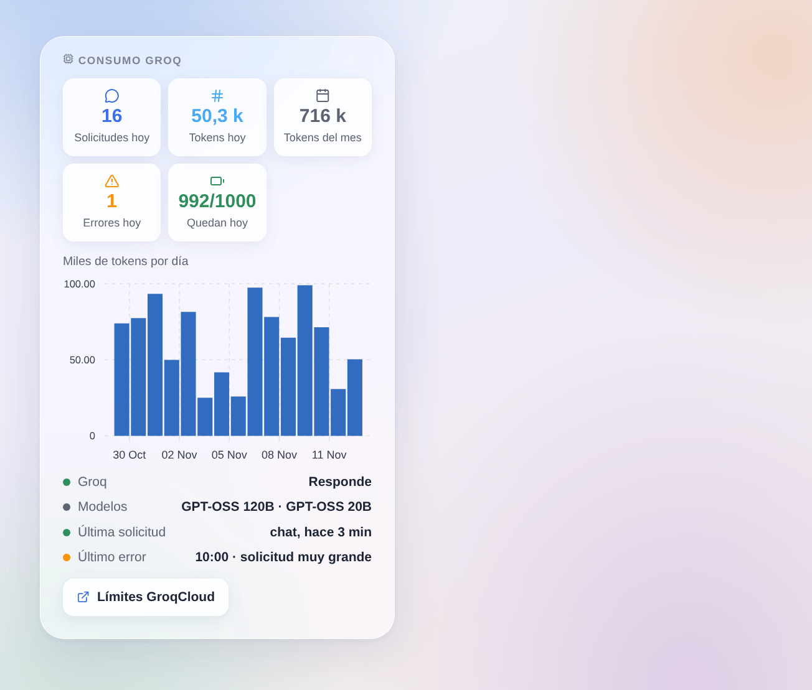

# Groq

## Presentación

Esta integración ejecuta el asistente de Gladys en **Groq**, un servicio que sirve modelos de IA abiertos (OpenAI GPT-OSS, Qwen) en sus propios chips LPU, varias veces más rápido de lo habitual: el asistente responde casi al instante, lo que conviene a los comandos de voz. Una vez elegida en **Ajustes → Inteligencia artificial**, todas las solicitudes de IA de Gladys van a Groq: el chat y los dispositivos que controla, las escenas que crea, la acción de escena «preguntar a la IA» y el resumen semanal. Funciona con una clave gratuita de Groq, con o sin cuenta Gladys Plus.

También añade una acción de escena que hace una pregunta **con búsqueda web**, dos disparadores de escena (el asistente falla, el asistente vuelve a responder) y un widget del panel con las solicitudes, los tokens y las **solicitudes que quedan hoy**.

Sin relación con Groq. Todavía no probada con una clave real de Groq: se agradecen los comentarios.

## Requisitos

- Gladys Assistant 5.3.0 o posterior.
- Una cuenta de GroqCloud y una clave de API: [console.groq.com/keys](https://console.groq.com/keys) → **Create API Key**. El plan gratuito no pide tarjeta.
- **Plan gratuito**: por modelo, unas 30 solicitudes por minuto, 1000 al día y 8000 tokens por minuto; sus límites exactos están en [console.groq.com/settings/limits](https://console.groq.com/settings/limits). Un mensaje del chat hace al menos dos solicitudes (enrutador y luego chat). Una solicitud cuyo prompt más el presupuesto de respuesta supera los tokens de un minuto se rechaza: una casa con muchos dispositivos puede alcanzarlo, por eso la longitud máxima de respuesta es baja por defecto.
- **Plan Developer** (pago por uso): GPT-OSS 120B cuesta 0,15 $ por millón de tokens de entrada y 0,60 $ por millón de salida, GPT-OSS 20B la mitad; los límites son mucho más altos. Un límite de gasto (Settings → Billing → Limits en console.groq.com) pone tope a la factura.
- Lo que sale de su casa: cada mensaje del chat, el historial, las herramientas que ofrece Gladys y sus resultados (el estado de los dispositivos que consulta el asistente) y las imágenes del chat van a Groq por HTTPS. Las respuestas controlan sus dispositivos y crean escenas.

## Configuración

| Campo o botón                         | Por defecto  | Significado                                                                                    |
| ------------------------------------- | ------------ | ---------------------------------------------------------------------------------------------- |
| Clave de API de Groq                  | —            | Obligatoria (empieza por `gsk_`). Nunca se vuelve a mostrar ni se registra                     |
| Modelo del chat                       | GPT-OSS 120B | Responde al chat, crea las escenas, redacta el resumen semanal                                 |
| Modelo del enrutador                  | GPT-OSS 20B  | Clasifica cada mensaje antes de la respuesta y debe responder en menos de 20 segundos          |
| Identificador del otro modelo         | —            | Solo para «Otro modelo»: el identificador exacto de la documentación de Groq (¡herramientas!)  |
| Razonamiento del modelo del chat      | Bajo         | Más razonamiento, mejores escenas, respuestas más lentas que consumen más tokens               |
| Longitud máxima de respuesta (tokens) | 4096         | Razonamiento incluido; en el plan gratuito cuenta en los tokens del minuto                     |
| Nivel de servicio                     | Bajo demanda | Auto: el mejor nivel de su organización. Flex (de pago): límites altos, falla si está saturado |
| Probar la conexión                    | —            | Una respuesta corta de cada modelo con su tiempo y las solicitudes que quedan hoy              |

El estado de la pantalla de configuración indica si Groq acepta la clave y lista ambos modelos, sin gastar nada, y avisa cuando se elige un modelo en versión preliminar o el nivel flex.

## Uso

1. Integraciones → **Groq** → Configuración: pegue la clave de API, mantenga los modelos por defecto, pulse **Probar la conexión**.
2. Ajustes → **Inteligencia artificial**: elija **Groq**.
3. Hable con Gladys en el chat: «enciende el salón», «¿qué temperatura hace en el dormitorio?», «crea una escena que cierre las persianas al atardecer».

### Elegir los modelos

- **GPT-OSS 120B** (por defecto para el chat): el mayor modelo abierto de OpenAI, fiable con las herramientas, unos 500 tokens por segundo.
- **GPT-OSS 20B** (por defecto para el enrutador): el doble de rápido y a mitad de precio; también un buen modelo de chat para una casa pequeña.
- **Qwen 3.8 27B**: lee las imágenes del chat y puede responder sin razonamiento; un modelo en versión preliminar, que Groq puede retirar con poco aviso.
- **Otro modelo**: cualquier identificador de [console.groq.com/docs/models](https://console.groq.com/docs/models) que admita herramientas, por ejemplo el sucesor de un modelo retirado.

GPT-OSS siempre razona un poco: el nivel «Desactivado» le da el bajo. Si otro modelo rechaza el parámetro de razonamiento, la integración lo envía sin él a partir de entonces.

### Widget del panel

El widget **Consumo Groq** muestra las solicitudes, los tokens y los errores del día, los tokens del mes, las solicitudes que le quedan hoy al modelo del chat (según los límites que Groq envía con cada respuesta), los tokens por día durante 30 días, si Groq responde, los modelos, la última solicitud y el último error. Groq no da coste por solicitud: la consola de GroqCloud sigue siendo la referencia para la factura.

### Escenas

- **Acción «Groq: preguntar con búsqueda web»**: GPT-OSS busca en la web con la búsqueda integrada en Groq y responde en unas pocas frases. Campos: la pregunta (se admiten variables de escena), instrucciones adicionales. Salidas: la respuesta y las fuentes, una por línea. Las páginas leídas cuentan como tokens: en el plan gratuito, una búsqueda puede gastar los tokens de un minuto.
- **Disparador «Groq: el asistente falla»**: una vez por fallo (clave rechazada, límite de gasto, límite de solicitudes, solicitud demasiado grande para el plan, modelo no disponible, API inaccesible, demasiado lento, error de Groq), con el tipo, el mensaje, la solicitud y el modelo.
- **Disparador «Groq: el asistente vuelve a responder»**: la primera respuesta tras un fallo, con los minutos de fallo.

Ejemplos: cada mañana, preguntar con búsqueda web por las noticias del día y enviar la respuesta por Telegram; cuando el asistente falla por un límite de solicitudes, enviar un mensaje al administrador.

## Solución de problemas

- **«Groq ha rechazado la clave de API»**: copie de nuevo la clave desde console.groq.com/keys; una clave borrada da el mismo mensaje.
- **«Una solicitud del asistente supera los tokens por minuto»**: reduzca la longitud máxima de respuesta (2048 suele bastar), elija GPT-OSS 20B o pase al plan Developer.
- **«Se ha alcanzado el límite de Groq»**: se han agotado las solicitudes o los tokens del minuto o del día. Espere o pase al plan Developer.
- **«Se ha alcanzado el límite de gasto de la organización de Groq»**: auméntelo en console.groq.com o espere al día 1 del mes.
- **«… no está disponible para esta clave de Groq»**: el identificador es erróneo, el modelo se retiró o el proyecto lo bloquea (permisos de modelos).
- **«cannot read images»**: elija Qwen 3.8 27B como modelo del chat.
- **«The answer was cut at max_tokens»**: aumente la longitud máxima de respuesta.
- Registros: Ajustes → Supervisión, los registros de la integración. No comparta nunca su clave de API.
