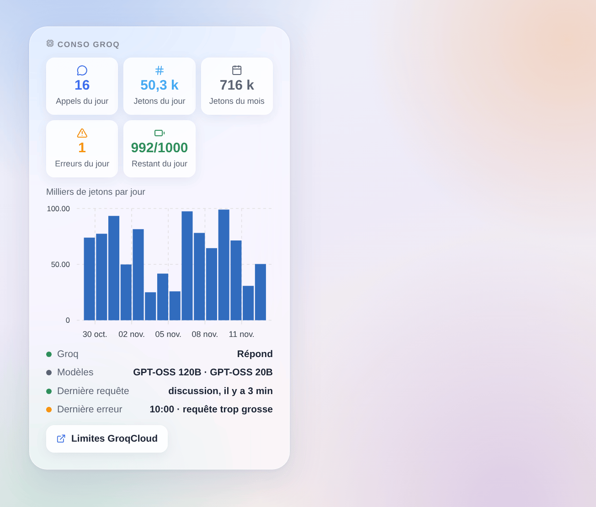

# Groq

## Présentation

Cette intégration fait tourner l’assistant de Gladys sur **Groq**, un service qui sert des modèles d’IA ouverts (OpenAI GPT-OSS, Qwen) sur ses propres puces LPU, plusieurs fois plus vite que d’habitude : l’assistant répond presque aussitôt, ce qui convient bien aux commandes vocales. Une fois choisie dans **Paramètres → Intelligence artificielle**, toutes les requêtes d’IA de Gladys partent vers Groq : le chat et les appareils qu’il pilote, les scènes qu’il crée, l’action de scène « demander à l’IA » et le résumé hebdomadaire. Elle fonctionne avec une clé Groq gratuite, avec ou sans compte Gladys Plus.

Elle ajoute aussi une action de scène qui pose une question **avec recherche web**, deux déclencheurs de scène (l’assistant est en erreur, l’assistant répond de nouveau) et un widget de tableau de bord avec les requêtes, les jetons et les **requêtes restantes du jour**.

Sans lien avec Groq. Pas encore testée avec une vraie clé Groq : les retours sont bienvenus.

## Prérequis

- Gladys Assistant 5.3.0 ou plus récent.
- Un compte GroqCloud et une clé d’API : [console.groq.com/keys](https://console.groq.com/keys) → **Create API Key**. L’offre gratuite ne demande pas de carte.
- **Offre gratuite** : par modèle, environ 30 requêtes par minute, 1 000 par jour et 8 000 jetons par minute ; vos limites exactes sont sur [console.groq.com/settings/limits](https://console.groq.com/settings/limits). Un message du chat fait au moins deux requêtes (routeur, puis chat). Une requête dont le prompt plus le budget de réponse dépasse les jetons d’une minute est refusée : une maison avec beaucoup d’appareils peut l’atteindre, c’est pourquoi la longueur maximale d’une réponse est basse par défaut.
- **Offre Developer** (paiement à l’usage) : GPT-OSS 120B coûte 0,15 $ par million de jetons en entrée et 0,60 $ par million en sortie, GPT-OSS 20B moitié moins ; les limites sont bien plus hautes. Une limite de dépense (Settings → Billing → Limits sur console.groq.com) plafonne la facture.
- Ce qui sort de chez vous : chaque message du chat, l’historique, les outils que Gladys propose et leurs résultats (l’état des appareils que l’assistant consulte) et les images du chat partent vers Groq en HTTPS. Les réponses pilotent vos appareils et créent des scènes.

## Configuration

| Champ ou bouton                          | Défaut       | Rôle                                                                                             |
| ---------------------------------------- | ------------ | ------------------------------------------------------------------------------------------------ |
| Clé d’API Groq                           | —            | Obligatoire (elle commence par `gsk_`). Plus jamais affichée, jamais journalisée                 |
| Modèle du chat                           | GPT-OSS 120B | Répond au chat, crée les scènes, rédige le résumé hebdomadaire                                   |
| Modèle du routeur                        | GPT-OSS 20B  | Trie chaque message avant la réponse et doit répondre en moins de 20 secondes                    |
| Identifiant de l’autre modèle            | —            | Seulement pour « Autre modèle » : l’identifiant exact de la doc de Groq (outils !)               |
| Réflexion du modèle du chat              | Faible       | Plus de réflexion, de meilleures scènes, des réponses plus lentes qui consomment plus            |
| Longueur maximale d’une réponse (jetons) | 4096         | Réflexion comprise ; avec l’offre gratuite elle compte dans les jetons de la minute              |
| Niveau de service                        | À la demande | Auto : le meilleur niveau de votre organisation. Flex (payant) : limites hautes, échec si chargé |
| Tester la connexion                      | —            | Une réponse courte de chaque modèle avec son temps et les requêtes restantes du jour             |

Le statut de l’écran de configuration indique si Groq accepte la clé et liste les deux modèles, sans rien dépenser, et prévient quand un modèle en préversion ou le niveau flex est choisi.

## Utilisation

1. Intégrations → **Groq** → Configuration : collez la clé d’API, gardez les modèles par défaut, appuyez sur **Tester la connexion**.
2. Paramètres → **Intelligence artificielle** : choisissez **Groq**.
3. Parlez à Gladys dans le chat : « allume le salon », « quelle température dans la chambre ? », « crée une scène qui ferme les volets au coucher du soleil ».

### Choisir les modèles

- **GPT-OSS 120B** (défaut du chat) : le plus grand modèle ouvert d’OpenAI, fiable avec les outils, environ 500 jetons par seconde.
- **GPT-OSS 20B** (défaut du routeur) : deux fois plus rapide et deux fois moins cher ; un bon modèle de chat aussi pour une petite maison.
- **Qwen 3.8 27B** : lit les images du chat et peut répondre sans réflexion ; un modèle en préversion, que Groq peut retirer sans long préavis.
- **Autre modèle** : tout identifiant de [console.groq.com/docs/models](https://console.groq.com/docs/models) qui sait appeler des outils, par exemple le successeur d’un modèle retiré.

GPT-OSS réfléchit toujours un peu : le niveau « Désactivée » lui donne le niveau faible. Si un autre modèle refuse le paramètre de réflexion, l’intégration l’envoie sans, à partir de là.

### Widget du tableau de bord

Le widget **Conso Groq** affiche les requêtes, les jetons et les erreurs du jour, les jetons du mois, les requêtes qu’il reste aujourd’hui au modèle du chat (d’après les limites que Groq envoie avec chaque réponse), les jetons par jour sur 30 jours, si Groq répond, les modèles, la dernière requête et la dernière erreur. Groq ne donne pas de coût par requête : la console GroqCloud reste la référence pour la facture.

### Scènes

- **Action « Groq : demander avec recherche web »** : GPT-OSS cherche sur le web avec la recherche intégrée à Groq et répond en quelques phrases. Champs : la question (variables de scène acceptées), des consignes en plus. Sorties : la réponse et les sources, une par ligne. Les pages lues comptent en jetons : avec l’offre gratuite, une recherche peut consommer les jetons d’une minute.
- **Déclencheur « Groq : l’assistant est en erreur »** : une fois par panne (clé refusée, limite de dépense, limite de requêtes, requête trop grosse pour l’offre, modèle indisponible, API injoignable, trop lent, erreur de Groq), avec le type, le message, la requête et le modèle.
- **Déclencheur « Groq : l’assistant répond de nouveau »** : la première réponse après une panne, avec les minutes de panne.

Exemples : chaque matin, demander avec recherche web les actualités du jour et envoyer la réponse par Telegram ; quand l’assistant est en erreur à cause d’une limite de requêtes, envoyer un message à l’administrateur.

## Dépannage

- **« Groq a refusé la clé d’API »** : recopiez la clé depuis console.groq.com/keys ; une clé supprimée donne le même message.
- **« Une requête de l’assistant dépasse les jetons par minute »** : baissez la longueur maximale d’une réponse (2048 suffit souvent), choisissez GPT-OSS 20B, ou passez à l’offre Developer.
- **« Limite de Groq atteinte »** : les requêtes ou les jetons de la minute ou du jour sont épuisés. Patientez, ou passez à l’offre Developer.
- **« La limite de dépense de l’organisation Groq est atteinte »** : relevez-la sur console.groq.com, ou attendez le 1er du mois.
- **« … n’est pas disponible pour cette clé Groq »** : l’identifiant est faux, le modèle a été retiré, ou le projet le bloque (permissions des modèles).
- **« cannot read images »** : choisissez Qwen 3.8 27B comme modèle du chat.
- **« The answer was cut at max_tokens »** : augmentez la longueur maximale d’une réponse.
- Journaux : Paramètres → Supervision, les journaux de l’intégration. Ne partagez jamais votre clé d’API.
